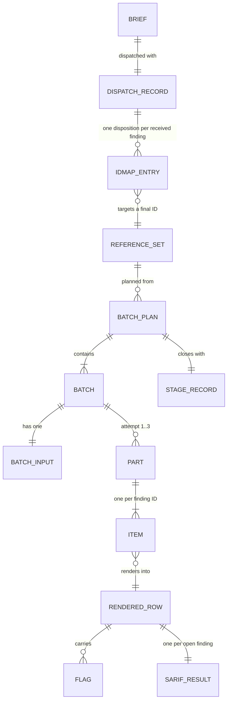

# Data Model: Large-Architecture Pipeline Resilience

The entities that F-374 adds or changes, how they relate, and their states. The key sets, types and ranges are normative in [contracts/](contracts/), and [ADR-050](../../docs/architecture/02_ADRs/ADR-050-large-architecture-output-authority.md) governs where the two disagree. Every JSON file names `schema: "tachi.<kind>/<major>"`, has a closed key set, and is read as untrusted input by `tachi_parts` (NFR-10; D3, D15).

## Entities

| Entity | Written by | Read by | Where | Contract | Track |
|---|---|---|---|---|---|
| **Reference finding set** | (derived) the wrapper in `tachi_parsers` | every parity check, the planner, the emitter | `threats.md` Section 7 (open) and Section 4c (RESOLVED) | spec FR-E.16, S-12 | S |
| **Batch plan** (`tachi.plan/1`) and its pointer (`tachi.plan-pointer/1`) | `tachi-stage.py plan` (replaced atomically by `reconcile`; each call prints its `plan_digest`) | the reconciler, the renderers, `fail`, `close`, each checking `--plan-digest` | `{out}/.tachi-build/<stage>/<plan_id>/plan.json`; `<stage>/current.json` | part-files.md §4 | S |
| **Pre-image copy** and **staged output** | `plan` (a copy of each existing canonical file); the renderer (stamped output, checked before replace) | `fail`, which restores a pre-image whose digest matches; the renderer's from-disk checks | `<plan_id>/preimage/`, `<plan_id>/staged/` | ADR-050 D4 | S |
| **Batch input** (`tachi.batch-input/1`) | the planner | the writer agent named in it | `<plan_id>/inputs/<batch_id>.json` | part-files.md §3 | S |
| **Part** (`tachi.part/1`) | a writer agent, in one Write | the renderer or assembly step, after validation | `<plan_id>/parts/<batch_id>.a<n>.json` | part-files.md §1; stage payloads | S (envelope); R and O (payloads) |
| **Overflow error** (`tachi.overflow/1`) | a writer agent at its part path, or a read-only agent as a reply line | the reconciler (advisory; counted only) | the part path, or the dispatch record | part-files.md §2 | S |
| **Stage record** (`tachi.stage-record/1`) | the renderer (scorer, controls) or `tachi-stage.py close` (threat model), which folds in the checks' hand-off files from `<plan_id>/checks/`; `tachi-stage.py fail` on a failure, in any stage | adopters, #399's manifest | `<plan_id>/stage-record.json` | part-files.md §5 | S |
| **Scored item** (scorer payload) | `tachi-risk-scorer` | `render-risk-scores.py` | inside a part | part-files.md, stage payloads | R |
| **Controls item** (controls payload) | `tachi-control-analyzer` | `render-compensating-controls.py` | inside a part | part-files.md, stage payloads | R |
| **Flag** (`kind:field:cause`; kinds `corrected`, `unverifiable`, `unchecked`, `divergent`, `override`, `resolved`, `retagged`, `reused-id` and `input`) | the renderers | readers of `risk-scores.md` §6, controls §7, and the SARIF `score-flags` and `integrity-flags` | `risk-scores.md` (the `Flags` column, §3 `**Integrity**:`, §6), controls §7, SARIF properties | ADR-050 D3, D7, D9 | R |
| **SARIF result** | the shared emitter (`sarif_common.py`) | GitHub Code Scanning, downstream tools | the three `.sarif` files | sarif-result.md | R (scorer, controls); O (`threats.sarif`) |
| **Architecture-source line** | `tachi-stage.py architecture-source` | the scorer and controls commands, the generator | the `threats.md` body | ADR-050 D7 | R |
| **ID high-water mark line** | `tachi-stage.py id-mark` (Step 2.7, PR 2) | Phase 3's numbering in the next run; `check-threat-model.py` | the `threats.md` body | ADR-050 D7; threat-model-records.md | O |
| **Phase 1 tables** (`tachi.phase1-inventory/1`, `tachi.phase1-dispatch/1`) | the orchestrator | briefs, the chain script, the checks | `{out}/.tachi-build/phase1/` | threat-model-records.md | O |
| **Brief** (`tachi.brief/1`) | the orchestrator | the dispatched threat agent, the checks | `{out}/.tachi-build/briefs/<dispatch_id>.json` | threat-model-records.md | O (template S) |
| **Dispatch record** (`tachi.dispatch-record/1`, a manifest) | the orchestrator, once per dispatch | `check-threat-model.py` | `{out}/.tachi-build/records/<dispatch_id>.json` | threat-model-records.md | O (template S) |
| **ID map** (`tachi.idmap/1`) | the orchestrator, at the end of Phase 3 | `check-threat-model.py` | `{out}/.tachi-build/idmap.json` | threat-model-records.md | O |
| **Chain set** (`tachi.chains/1`) and **narratives** (`tachi.chain-narratives/1`) | `attack-chains.py plan`; the orchestrator | `attack-chains.py render` | `{out}/.tachi-build/chains/` | threat-model-records.md | O |
| **Outcome record** | `attack-chains.py render`; rewritten by `check` (R-24) | the report agent, `detect_artifacts`, `prepare_attack_chains`, `main.typ` | the `threats.md` body, under `## Attack Chain Outcome` | threat-model-records.md | O |
| **Merged tree manifest** (schema 1.0, unchanged) | `assemble-report.py trees` | the report agent | `attack-trees/.manifest.json` | threat-model-records.md | O |

## Relationships



- **One plan per command invocation and stage.** A re-run makes a fresh `plan_id` and replaces the pointer atomically. Nothing under `.tachi-build/` is deleted, and a part counts only when its `plan_id` matches the pointer (D3).
- **One part per batch attempt.** A batch's units are a contiguous run in S-2 order. Retries halve a batch (children `B003-1`, `B003-2`) or repeat it, within the retry cap (D6).
- **One SARIF result per open finding**, in every file. Correlation lives in each member's `properties` (D8).
- **One provenance entry per final finding** (dispatch record, carry-forward or rule), and one disposition per finding a record received (D12).

## State transitions

**Batch** (in `plan.json`):

```
pending ──part valid──▶ done
pending ──missing / overflow / unparseable──▶ split (children pending, halved)
pending ──invalid──▶ pending (retry, same members)
any ──retry cap or stage budget exhausted──▶ failed  ⇒ reconcile exits 4 ⇒ `fail`
```

**Stage** (the stage record's `status`):

```
planned ──reconcile 0, render 0──▶ success
planned ──reconcile 0, render 5──▶ success-with-warnings
planned ──exit 4, or D-3's three paths──▶ failed  (changed canonical files moved to <plan_id>/failed/)
```

**Phase 3.5 outcome** (D13; R-24):

```
render ──N ≥ 1──▶ "chains written (N); candidates C; surfaced S"
render ──N = 0──▶ "0 chains passed filter (<reason>); candidates C"
render ──input unusable──▶ "skipped (<reason>)"
check  ──record missing, malformed or inconsistent──▶ "skipped (<what disagreed>)" + attack-chains.md → attack-chains.inconsistent.md
```

**Carried finding** (D9):

```
inputs inherited ──recompute──▶ equal: unchanged
                            ├─▶ rounding-only, band holds: normalized (counted)
                            ├─▶ rounding-only, band moves: corrected:severity_band:rounding
                            ├─▶ explained by the tags alone: retagged:<field>:asset-tags (ruling A's review date)
                            ├─▶ other difference: corrected:<field>:<cause>
                            ├─▶ no vector: unverifiable
                            └─▶ N17-dependent: unchecked (value kept)
```

## Validation rules (summary; NFR-10 and D3 are normative)

- **Paths:** planned, a regular file, no symlink under `{out}`, and inside it by identity. Scripts recompute every path from `--out` and IDs, except the plan's digest-checked `inputs`, and check `--plan-digest`. IDs pass `tachi_parts`' allow-lists before they become paths, and compare in canonical form.
- **Parsing:** strict UTF-8 JSON with no duplicate keys, no NaN or Infinity, floats parsed as `Decimal`, and integer literals of at most 20 digits. Nesting is at most 8 levels, and a part is at most 512 KiB.
- **Closed keys:** `schema` selects the key set (a part or an overflow error), then the closed keys, then types and ranges.
- **Plan match:** `plan_id`, `batch_id`, `stage` and `agent_type` equal the plan's, and `finding_ids` equals the planned set.
- **Strings:** each has one class: closed value, narrative or evidence. No C0 or C1 control characters (except `\n` and `\t`), no bidi controls (U+200E, U+200F and U+061C included), no U+2028 or U+2029. Narrative fields have no numerals outside the `{{kind:arg}}` slots of D3's table, and a field that fails takes the per-field fallback instead of rejecting the part.
- **Output rules:** untrusted strings only, truncated first, then escaped with references that `tachi_parsers` decodes; no prose line starting with `#` or `|`; fences longer than any backtick run inside them; SARIF strings written through `json.dumps`.
