---
triad:
  pm_signoff:
    agent: product-manager
    date: 2026-11-22
    status: APPROVED_WITH_CONCERNS
    notes: "Plan review: 8 findings (1 HIGH, 3 MEDIUM, 4 LOW). Rulings A (asset tags and the SLA clock), B (IDs never reissued), C (correlation named in the message) and P-7 (at most 10% per stage) were AMENDED and folded verbatim in ADR-050, the spec and the plan; findings 1 to 8 were folded in rev. 1. Rev. 1 confirmation (condition 3): CONFIRMED_WITH_AMENDMENTS. retagged covers every value the tags alone move; the peer cap is 10; TW-L2 keeps 10% as the follow-up trigger and adds a PM return above 25% in any W5 run; the contract text states the check (no digit outside a slot); the reference-set oracle class is bounded; the narrowing of PM 1(b)'s ref is accepted. Standing condition 4: a PR 1 projection above 9.0 days returns to the PM before /aod.tasks signs off, with the driving items named. Full: .aod/results/product-manager-374-plan.md and .aod/results/product-manager-374-plan-confirm.md"
  architect_signoff:
    agent: architect
    date: 2026-11-22
    status: APPROVED_WITH_CONCERNS
    notes: "First review: CHANGES_REQUESTED, 18 findings (4 HIGH: slot rules, replace before check, escaping, Track O order). Re-review of rev. 1: APPROVED_WITH_CONCERNS. 17 of 18 fixes are sufficient; F7 is partial in PR 2 and tracked as RR3. New findings: 0 HIGH, 2 MEDIUM (RR1: carried prose keeps its slots; RR2: over-limit prose is cut and flagged, not rejected), 4 LOW and nits, all folded in rev. 2 and checked by the lead. O-α (phase2), O-β (threats-md), O-γ (the report payload) and RR3 are ruled as ADR-050 revisions before W2′ under TW-ADR, and each contingency is priced as its own line at /aod.tasks. ADR-050 is Accepted (provisional pre-PR). Full: .aod/results/architect-374-plan.md, architect-374-plan-rereview.md and architect-374-plan-rev2.md"
  techlead_signoff: null  # Added by /aod.tasks
---

# Implementation Plan: Large-Architecture Pipeline Resilience

**Branch**: `374-large-architecture-pipeline-resilience` | **Date**: 2026-11-22 | **Spec**: [spec.md](spec.md) | **ADR**: [ADR-050](../../docs/architecture/02_ADRs/ADR-050-large-architecture-output-authority.md)
**Input**: Feature specification from `specs/374-large-architecture-pipeline-resilience/spec.md` (PM ⚠, 2026-11-22), PRD-374 v1.3, and the team-lead's feasibility check with its §13 addendum.

> **Two PRs (R-34).**
> - **PR 1 (draft #423)** carries Track S, the cut line, and Track R: the renderer, the scorer and controls contracts, and the parsers.
> - **PR 2** carries Track O: the orchestrator, the report, the chain script and the checks. It is opened against `main`.
>
> This plan covers both. Every work stream, gate and risk below carries its track, so `/aod.tasks` can sequence PR 1 on its own.

## Summary

The bundle moves what an agent can't reliably produce at scale (whole files, arithmetic, completeness, alert identity) into shipped, tested, stdlib-only Python. Agents keep the judgment, and each writes a bounded JSON part file per batch. The dispatching layer plans, batches, reconciles and resumes from disk. ADR-050 records the sixteen technical decisions PRD §13 requires, each tagged with its track.

- **Track S, the cut line (PR 1, end of W1).**
  - **ADR-050 and the shared references:** the N/N and identity rule, the overflow error and batch plan, the part envelope, the dispatch-record and brief templates, and the canonical agent roster.
  - **N4's and N14's contract text:** typed dispatch, no code hand-backs, the overflow contract, and the platform-neutral clauses removed.
  - **The renderer core:** the part loader and validator (NFR-10), the CVSS 3.1 module promoted from Patch A's test, the shared SARIF emitter, and the planner and reconciler.
  - **The synthetic fixture and its generator** (S-4).
- **Track R (PR 1).**
  - **Scorer:** a risk-scores renderer that owns both files, with recompute-and-flag and a separate scoring-rules module (R-25, R-26, R-31). `/tachi.risk-score` gets a batch-and-resume loop.
  - **Controls:** a controls renderer that owns both files. Sections 2 and 4 stay model-authored inside the parts and are filled or checked cell by cell (R-34), and `/tachi.compensating-controls` gets a loop of its own.
  - **Identity:** stable identity for the scorer and controls SARIF, plus the architecture-path carrier (FR-E.18).
  - **Parsers:** they read K8's corrected format, the pre-fix format, and the drift forms in tachi's own samples (S-12).
- **Track O (PR 2).**
  - **Dispatch:** typed Phase 2 dispatch with records, briefs and the ID map, then the provenance and completeness checks.
  - **Phase 2 overflow:** re-dispatch per component (spiked first, S-9).
  - **The orchestrator's outputs:** bounded `threats.md` emission and a shipped `threats.sarif` generator.
  - **Phase 3.5:** a shipped chain script with an outcome record and its check.
  - **The report:** assembled by a shipped step, with tree batches dispatched by the orchestrator.

**The approach is reuse-first.**
- **The production precedent.** `scripts/populate-affected-assets.py` is a pure-function core with a thin CLI and `--check`. It is the model for every new script.
- **What already exists.** `tachi_parsers` supplies the readers (wrapped, never changed, for the reference set). The `_guard_build_dir` and `_is_safe_finding_id` guards supply path safety. Patch A's calculator and its FIRST examples supply CVSS, and `Decimal` with `ROUND_HALF_UP` already handles rounding.
- **No new dependency is added.** The only net-new code is what D-2 and D-3 require: the renderer, the planner and reconciler, the joiner and assembly steps, the chain script and the checks.

## Technical Context

**Language/Version**:
- **Python 3.9 or later** for every new shipped script (S-11). Main's gates run 3.11, and a 3.9 grammar check runs in CI.
- **Bash 3.2+** for any command or shell change, on BSD and GNU userlands (NFR-9).
- **Markdown and YAML** for the agent, command, skill and template text.

**Primary Dependencies**: none new.
- **The core path** (renderer, planner, reconciler, joiner, assembly, chain script, checks) imports and needs only the standard library: `json`, `decimal`, `hashlib`, `re`, `pathlib`, `os`, `sys`, `datetime`, `argparse` and `tempfile`.
- **PyYAML** stays optional, for the PDF attestation page only. A test runs the core path with `yaml` made unimportable (S-11).
- **Tests** use the existing `pytest>=8` and `pytest-timeout>=2` (plus `pyyaml>=6`, for collection only).

**Storage**: files. Agents write their intermediates under `{out}/.tachi-build/` (ADR-049 D7), and the final outputs keep their names and locations.

**Testing**:
- pytest on synthetic fixtures only (NFR-6, S-4), in three gates (FR-E.5):
  - `tachi-install-fidelity.yml`, the default for the renderer, checker and parser suites;
  - `tachi-pytest.yml`, only for modules that need its two-OS bash matrix;
  - `tachi-permissions-verify.yml`, for agent, command, §8 and runbook edits.
- Live runs (`[MANUAL-ONLY]`) are recorded in the PRs (D-7, R-18).

**Target Platform**: Claude Code on macOS and Linux, as adopters run tachi. CI runs on Ubuntu and macOS.

**Project Type**: single repository (a harness of agents, commands, skills, templates and scripts). No service and no API.

**Performance Goals**:
- **At scale.** A stage on the fixture (390+ open findings, at least 40 Critical) completes on contract (SC-1).
- **Small runs** cost no more output tokens than at v4.48.4, within P-7's tolerance for each stage (SC-8, NFR-4).
- **Batch size.** Each batch's expected writes stay within S-1's budget: at most 8,000 tokens per write and 32,000 per batch.

**Constraints**:
- No agent gains a tool (NG8), and commands keep `{description}` (C5).
- Orchestrator fences use only `python3` (C6).
- Every write stays under `{out}` (ADR-049 D5).
- At most 20 subagents are in flight, nesting goes at most three layers deep, and every dispatch runs in the foreground (S-8).
- Re-rendered example PNGs are never committed (#365).
- Public text stays generic (NFR-6).

**Scale/Scope**: 54 FRs in 5 groups and 16 ADR-050 decisions, across two PRs. About 30 agent, command, skill, template and doc files are edited; about 9 new scripts plus their helpers, and their test modules, are added.

## Constitution Check

*GATE: evaluated before Phase 0 and re-checked after the Phase 1 design. **PASS**: no violations, and Complexity Tracking records one justified change of tier.*

- **I. General-Purpose.** The renderer, planner and checks are generic over findings and IDs. Nothing in them is specific to a target or an example. PASS.
- **II. API-First.** N/A: there is no API. The interfaces are CLI and file contracts, documented in `contracts/` and `data-model.md`.
- **III. Backward Compatibility (non-negotiable).**
  - **Additive outputs.** Adopter outputs keep their sections and fields. The exceptions are D-5's identity, the corrected values, and K8's Section 2 columns (spec §6).
  - **Readers.** The parsers read the pre-fix formats and tachi's own drift forms (S-12).
  - **Old inputs** render byte-identically.

  The behavior changes are deliberate, disclosed in each PR's binding release notes (spec, "Release notes, per PR"), and released as `fix:` (R-1): the re-key events, the new stops, and recomputed scores. PASS.
- **IV. Concurrency / V. Privacy.** N/A as written, since tachi is a local harness. The equivalents are S-8 (dispatch limits), NFR-6 (public hygiene) and NFR-10 (the trust boundary). PASS.
- **VI. Testing Excellence.**
  - Every deterministic claim has an offline test on synthetic fixtures, gated in CI. The renderer's contract and golden tests are written before its code (W2).
  - Model behavior is measured by live runs, with dispositions decided in advance (TW-L2).

  PASS.
- **VII. Definition of Done.** Three-step validation per PR, with red CI blocking merge. PASS.
- **VIII. Product-Spec Alignment.** Every FR traces to the spec and the PRD, the PM's spec-review rulings are binding, and nothing here adds product scope. PASS.
- **X. Governance (non-negotiable).** ADR-050 is accepted at this stage, before any build wave (TW-ADR). It records an amendment for every ADR it overrides: ADR-013, 017, 018, 020, 026, 046, 048 and 049 (P-1). ADR-047 is unchanged, because SV-2b is carved (D1). PASS.

**Post-design re-check:** PASS. The Phase 1 artifacts add no dependency, no agent tool and no write outside `{out}`.

## Tech Stack

| Layer | Technology | Notes |
|---|---|---|
| Shipped scripts | Python 3.9+, standard library only | `sys.dont_write_bytecode` set before local imports (ADR-049 D8); installed through `INSTALL_MANIFEST.md`; listed under S-13 |
| Agent and command contracts | Markdown, with YAML frontmatter | Agents keep their `tools:`; commands keep `{description}` |
| Intermediates | JSON (closed, versioned key sets) | Under `{out}/.tachi-build/` (ADR-050 D3) |
| Outputs | Markdown and SARIF 2.1.0 | Renderer-owned for the scorer and controls (PR 1), and the `threats.sarif` generator (PR 2) |
| Tests and CI | pytest; GitHub Actions | Three gates, with lock-step `paths:` and invocation (FR-E.5) |

## Components

| Component | Kind | Track | Role (ADR-050) |
|---|---|---|---|
| `scripts/tachi_parts.py` | helper, new | S | Part loader and validator, the identifier patterns, guards, atomic write, digest, stamp and version (D3, D4) |
| `scripts/tachi_scoring.py` | helper, new | S | The CVSS 3.1 calculator promoted from Patch A's test, the embedded constants, `q1`, `band`, largest remainder and the prefix resolver (D5, D10) |
| `scripts/sarif_common.py` | helper, now installed | S | The shared emitter: rule map, per-finding hash, URI resolver, membership and self-check (D7, D8) |
| `scripts/tachi-stage.py` | entry, new | S | `plan`, `reconcile`, `fail`, `close` and `architecture-source`, plus `id-mark` in PR 2 (D4, D6, D7) |
| `scripts/tachi_parsers.py` | helper, extended | S, R, O | The reference-set wrapper with drift forms (S-12), `parse_correlation_groups` (D8), both K8 formats, the shared reference decoder (D3), and `parse_chain_outcome` in PR 2 (D13) |
| `scripts/tachi_scoring_rules.py` | helper, new | R | R-6's resolver, R-25, R-26's tolerant reader and R-31 (D5, D9) |
| `scripts/render-risk-scores.py` | entry, new | R | Owns `risk-scores.{md,sarif}`; recompute-and-flag (D2, D9, D10). Replaces `generate-risk-scores-sarif.py` (#357) |
| `scripts/render-compensating-controls.py` | entry, new | R | Owns `compensating-controls.{md,sarif}`; Sections 2 and 4 filled or checked (D2, R-34) |
| `scripts/join-threats-md.py` | entry, new | O | Joins the bounded `threats.md` parts (FR-O.1) |
| `scripts/generate-threats-sarif.py` | entry, rewritten | O | The shipped `threats.sarif` generator, on the shared emitter (D1, D7, D8) |
| `scripts/attack-chains.py` | entry, new | O | `plan`, `render`, `check`: Phase 3.5's computation, the bound and the outcome record (D13) |
| `scripts/check-threat-model.py` | entry, new | O | Provenance, completeness, P-11 and Section 6 parity (D12) |
| `scripts/assemble-report.py` | entry, new | O | `trees` (copy and merge) and `report` (assembly, plus FR-K5.3, FR-K5.5 and FR-K5.7) (D14) |
| Agent and command contracts | modified | S (text), R, O | Typed dispatch, no hand-back, the overflow contract, batch-and-resume loops, judgment-only authoring |
| Shared references | new and modified | S | N/N and identity; the part-file contract; the overflow error and batch plan; the dispatch-record and brief templates; the roster; the end marker |

## Data Flow

```mermaid
flowchart TB
  subgraph PR1["PR 1: /tachi.risk-score and /tachi.compensating-controls (main session, depth 1)"]
    TM1["threats.md (reference set)"] --> POP["populate-affected-assets.py (scorer only)"]
    POP --> PLAN["tachi-stage.py plan"]
    PLAN -->|batch inputs| AG["tachi-risk-scorer / tachi-control-analyzer (≤16 in flight, foreground)"]
    AG -->|parts| REC["tachi-stage.py reconcile (exit 3 = dispatch more)"]
    REC -->|complete| REN["render-risk-scores.py / render-compensating-controls.py"]
    REC -->|exhausted, exit 4| FAIL["tachi-stage.py fail (failed/ quarantine)"]
    REN --> OUT1["risk-scores.{md,sarif} / compensating-controls.{md,sarif} (stamped)"]
    REN --> SR1["stage-record.json"]
  end
  subgraph PR2["PR 2: /tachi.threat-model"]
    M0["main: Step 1.5, the run-level plan"] --> O1["orchestrator: Phase 1 tables, briefs"]
    O1 --> O2["Phase 2: typed agents (records) + per-component re-dispatch"]
    O2 --> O3["Phases 3, 3.6 and 4 → threats-md parts → join-threats-md.py"]
    O3 --> O4["attack-chains.py plan / render (outcome record)"]
    O4 --> O5["Phase 5: tree batches → assemble-report.py trees → report batches"]
    O5 --> M1["main: architecture-source · id-mark · attack-chains.py check · check-threat-model.py"]
    M1 --> M2["assemble-report.py report → generate-threats-sarif.py → tachi-stage.py close"]
  end
```



- **PR 1's flow** stands alone: the scorer and controls stages read a `threats.md` and its baseline run. PR 1 changes the threat model only by its presence check and Step 2.7's body-line write (D7).
- **What PR 2 moves.** Its flow moves `threats.sarif` and the checks into the main session, after the orchestrator returns. The orchestrator authors no SARIF and assembles no report (D4).

## Project Structure

### Documentation (this feature)

```
specs/374-large-architecture-pipeline-resilience/
├── spec.md                 # PM-approved spec (/aod.spec)
├── research.md             # Spec-stage research, plus the plan-stage decisions appended
├── feasibility-check.md    # Team-lead estimate (define stage) and §13 addendum
├── plan.md                 # This file
├── data-model.md           # Entities: part envelope and payloads, plan, records, flags
├── quickstart.md           # How to run the offline suite, the fixture and the live matrix
├── contracts/              # JSON key sets and CLI contracts for every new script
├── checklists/requirements.md
└── tasks.md                # /aod.tasks output (next)
docs/architecture/02_ADRs/ADR-050-large-architecture-output-authority.md
```

### Source Code (repository root: the surfaces this bundle changes)

```
scripts/                                    # new and changed scripts: see Components (all installed, under S-13)
.claude/agents/tachi/                       # orchestrator, risk-scorer, control-analyzer, threat-report, attack-tree-delta (+ platform-neutral clauses in report-assembler, threat-infographic)
.claude/commands/                           # tachi.threat-model.md, tachi.risk-score.md, tachi.compensating-controls.md
.claude/skills/tachi-shared/references/     # new: N/N and identity, part-file contract, overflow and batch plan, dispatch-record and brief templates, roster; finding-format-shared.md (end marker)
.claude/skills/tachi-orchestration/references/  # sarif-specification.md, output-schemas.md, dispatch-rules.md, baseline-correlation.md
.claude/skills/tachi-risk-scoring/references/   # cvss-vectors.md, asset-modifiers.md, severity-bands.md (become renderer documentation)
.claude/skills/tachi-control-analysis/references/
.claude/skills/tachi-threat-reporting/references/
templates/tachi/output-schemas/             # threats.md, risk-scores.md (1.1), compensating-controls.md (1.1), threat-report.md
schemas/attack-chain.yaml                   # 1.1 (PR 2)
adapters/claude-code/                       # superseded-by headers, the README warning, sarif-generation.md (R-17, FR-K8.3)
tests/scripts/                              # new test modules (D16) and the fixture generator
tests/scripts/fixtures/large_arch/          # the committed fixture (S-4)
.github/workflows/                          # tachi-install-fidelity.yml (f374-offline, f374-py39-floor, f374-macos); tachi-pytest.yml paths
INSTALL_MANIFEST.md                         # the new scripts and helpers, in all three places
docs/standards/CLAUDE_PERMISSIONS.md        # §8.3–§8.5 (C7)
docs/guides/ISOLATED_OPERATION_TACHI.md     # §5, and the "Last validated" header (R-27)
docs/guides/DEVELOPER_GUIDE_TACHI.md        # the two upload snippets (FR-E.11)
docs/architecture/02_ADRs/                  # ADR-050, plus dated notes in the ADRs it amends
```

**Structure Decision**: a single repository. New logic goes into `scripts/` as installed stdlib modules, following the populator's precedent. Agent and command text changes in place, and no new top-level directory is added.

## Phase 0: Plan-Stage Decisions (all registered inputs resolved)

The Technical Context has no NEEDS CLARIFICATION. Spec-stage research (research.md) and four parallel architect passes resolved every input. They were merged into [ADR-050](../../docs/architecture/02_ADRs/ADR-050-large-architecture-output-authority.md).

| Input | Resolution |
|---|---|
| **P-1** ADR-050 | Sixteen decisions, each with its track. The amendments to ADR-013, 017, 018, 020, 026, 046, 048 and 049 are recorded, with back-pointer notes at the cut line. ADR-047 is unchanged (D1) |
| **P-2** #396 rule | This bundle lands first. Steps 2.5 and 3 keep their anchors and Step 2.6 stays free. New main-session steps are 2.7 (PR 1, plus `id-mark` in PR 2), and 1.5 and 2.8 to 2.10 (PR 2). Conflicts are filed on #400 |
| **P-3** outcome record | A body line under `## Attack Chain Outcome`, upserted by `attack-chains.py render`, with no schema bump (D13) |
| **P-4** failed outputs | The renderers check staged files before replacing anything. `tachi-stage.py fail` moves changed canonical files into `<plan_id>/failed/` and restores the pre-image copies. Auto-detection matches exact names only, so N7 is unchanged (D4) |
| **P-5** report assembly and trees | The orchestrator dispatches the tree and report batches, so dispatch stays two layers deep. The main session runs `assemble-report.py report` after the checks (D14) |
| **P-6** `.tachi-build/` layout | Planned stages use `<stage>/<plan_id>/{plan.json, inputs/, parts/, preimage/, staged/, stage-record.json, failed/}`, the run-level plan adds `checks/`, and a `trees` plan adds `trees/`. Track O's run files sit flat under `.tachi-build/`: `phase1/`, `briefs/`, `records/`, `idmap.json` and `chains/` (D3) |
| **P-7** SC-8 tolerance | Ruled by the PM at the plan review (2026-11-22): at most 10% per stage. The ruled text follows this table, and the spec's SC-8 carries it |
| **P-8** retry cap | At most 2 retries per batch lineage, and at most twice the planned batch count in retry dispatches per stage. Overflows halve the batch (D6) |
| **P-9** TW-N3 ordering | Kept generic in public text, and evaluated at `/aod.tasks` |
| **P-10** consequence scope | T001's pre-state census (Verification & Gates, item 1) |
| **P-11** missing dispatches | Adopted. `check-threat-model.py` compares the records with the persisted dispatch table (D11, D12) |
| **OQ-5** thresholds | S-1's budget. Planning sizes are 40 per scorer batch, 30 per controls batch and 12 trees, re-measured at W0 and W1 (D6) |
| **OQ-6** chain rules | S-2 and S-3 as amended by the PM, in a shipped chain script (D13) |
| **OQ-7** fixture | S-4 (D16 places its tests) |
| **SV-3** | Doesn't fire: identity needs only the finding ID, the file's constants and the architecture path (D8) |
| **SV-2b** | Carved at the plan stage: the tables stay model-authored, so the records are manifests (D1, D11) |

**P-7, as ruled by the PM at the plan review (2026-11-22), verbatim:**

> SC-8 passes when, for `/tachi.risk-score` and `/tachi.compensating-controls` separately, output tokens are at most 10% above that stage's v4.48.4 baseline.
> - **The runs.** Both use the same shipped example, named before W1's baseline run and below both stages' batching thresholds (NFR-4). Both run at the adopter default effort and under the same session conditions: if the post-fix run doubles as R-27's smoke run, the baseline also runs under the profile.
> - **Output tokens** are what Claude Code reports for the whole stage: the command's turns and every subagent, thinking included. They are read from the session's usage records. Quickstart §4 says the stage record, but it has no token field.
> - **Reporting.** The PR records each stage's actual delta. Public text claims a stage got cheaper only if its delta is below zero.
> - **Overage.** A stage still over 10% after TW-L2's second attempt comes back to me before PR 1 merges.

Quickstart §3 and §4 now follow it, and read tokens from the session's usage records.

**Ruled by the PM at the plan review (2026-11-22)** (ADR-050, "Ruled by the PM at the plan review"):
- **A:** a tag-driven band change is an input change, flagged `retagged`, with its own review-date rule (D9).
- **B:** IDs are never reissued: a high-water mark and a shipped check in PR 2, and the `reused-id` flag in both PR 1 renderers (D7).
- **C:** the placement is accepted, and each correlated result's message names its group (D8).
- **P-7:** above.

## Technical Approach: work streams → a two-PR wave sketch (the team-lead finalizes at `/aod.tasks`)

The lanes follow the feasibility check's §3.1. Each hot file has one lane per wave, code lanes are separate from contract-text lanes, and lane X applies the cross-cutting rows once per wave. R-34 splits the waves by PR.

> **Superseded at `/aod.tasks` (2026-11-22).** tasks.md v1.1 now owns four things:
> - **The windows.** Each comes from its wave's longest dependency chain plus its push-and-gate tail.
> - **PR 1's projection.** Its central is T0 + 10.05, and TW-0 is re-based to T0 + 11.0 under the PM's condition-4 ruling, Option A.
> - **PR 2's projection.** Its central is T0 + 13.75, against a bound of T0 + 14.75.
> - **PR 2's post-squash integration.** T127 names the method and the full-tree parity check, a departure from the rebase described below.
>
> The windows and centrals below are the plan stage's.

**PR 1: Tracks S and R** (planning central about T0 + 8.0; TW-0 bounds it at 9.0 days)
- **W0 (0.35 d).**
  - `devops`: T001's pre-state census in a scratch clone. It records each gate's literal totals and the consequence-scope list (P-10), and confirms that #365's known reds are attributed.
  - `debugger`: FR-K4.3's 5 Whys, time-boxed. It is evaluated at the end of W0 (TW-K4) and informs PR 2.
  - `tester`: starts the fixture generator (lane F).
  - **The S-1 proxy measurement:** output tokens per finding, per tree and per table row, measured on the largest shipped example. W1 confirms it on the fixture (ADR-050 D6).
- **W1, the cut line (window 1.0 d).**
  - **S:** the shared references (ADR-050 D3, D6, D7, D8), with D3's slot table and fixed fallback sentences; the roster; and the dispatch-record and brief templates with the end marker's provisional text, in a reference no PR 1 agent or command loads (D11). `test_contract_text_374.py` pins that they stay inert until PR 2.
  - **O1-text:** the N4 and N14 contract text, which ships in PR 1. It covers typed dispatch, the stop when a typed agent can't be spawned, no code hand-backs, the overflow contract, and removing the six platform-neutral clauses, each recorded in FR-E.17's ledger. Track O's own mechanics wait for PR 2.
  - **R0:** the renderer core, the CVSS module, the SARIF emitter, and the planner and reconciler.
  - **F:** the fixture and its generator (S-4). Then the pre-fix baseline on the fixture, before any renderer code lands (D-7): the token measurement, plus one v4.48.4 scorer run.
  - **X:** the W1 wiring rows.
  - **ADR back-pointer notes** in the ADRs that ADR-050 amends (P-1).
  - **Exit:** both CI legs green. This is the cut line.
- **W2 (window 2.0 d).**
  - **R1:** the risk-scores renderer with recompute-and-flag, its goldens written first.
  - **R1b:** the scoring-rules module (R-25, R-26, R-31 and ruling A), as a second lane. ADR-050 D5 rules it in, which keeps W2 inside PR 1's 8.0-day central.
  - **C:** the scorer contract, the command's batch-and-resume loop, and the adapter-copy header (R-17). Also D-6(a)'s count rewordings and the SARIF contract copy in `risk-scorer.md`, each recorded in FR-E.17's ledger.
  - **P:** the parsers, covering the drift forms (S-12), both K8 formats, the Section 4a group reader and the shared reference decoder (ADR-050 D3).
  - **Exit:** the architect's P0 checkpoint, then TW-ESC.
- **W3 (window 1.5 d).**
  - **R2:** the controls renderer, with Sections 2 and 4 filled or checked (R-34).
  - **R3a:** scorer and controls identity, the carrier (FR-E.18) and FR-E.2's model test.
  - **D:** the controls contract and command (python3 presence check, paths-not-contents input contract). Also the controls count rewording (`control-analyzer.md:383`) and the controls SARIF contract copies (Phase 6c, `sarif-generation.md`), each recorded in FR-E.17's ledger.
  - **X:** §8.3–§8.5, the runbook's §5, the manifest and CI. Also FR-E.11's two uploads in the developer guide, with D7's one-category-per-system note and the line telling adopters to ignore `**/.tachi-build/` (PM finding 6).
  - `security-analyst`: an advisory review of part validation and path handling.
- **W4 (window 0.65 d).**
  - The offline end-to-end run on the fixture, the evidence for SC-4, SC-5 (offline half) and SC-6 (R).
  - One push, with both CI legs green.
  - `code-reviewer`, the Step 7 security scan, and the architect's P1 checkpoint.
- **W5 (window about 1.0 d).** The live matrix for the scorer and controls on the fixture, at the default effort and at `effort=max` (R-18). Also:
  - SC-8's example run, under P-7's ruled conditions;
  - R-27's smoke run under the session profile (`/tachi.threat-model` on a shipped example, then both stages), with a before-and-after write listing;
  - each stage's narrative fallback rate, per run and effort level, under the PM's ruled dispositions (ADR-050 D3): a follow-up above 10%, and above 25% in any W5 run, the SC-8 small runs included, a return to the PM before PR 1 merges;
  - TW-L2's dispositions.
- **W6 (0.4 d), the close-out lane** (`product-manager` and `devops`, feasibility §3.2).
  - PR 1's release notes: all five items, as the spec's "Release notes, per PR" extends them.
  - FR-E.17's ledger in the PR body.
  - PRD §8's PR 1 bookkeeping: #357 closed; #408 and #409 updated (R-14, R-15); N14, N15 and N16 ticked on #397, with the N17(a) note.
  - S-16's KB entry on output-cap overflow, with the init-baseline regeneration in the same commit (D16).
  - The follow-ups (S-16), and delivery as a `fix(374)` patch.

**PR 2: Track O** (about T0 + 11 to 12; bounded at its planning central + 1.0)
- **Branch.** The Track O lanes may start after the cut line, on their own branch cut from the cut-line commit. PR 2's base is always `main` (KB 25). After PR 1 squash-merges, the branch is rebased onto `origin/main`, and the full tree is diffed (KB 18).
- **Before W2′:** ADR-050's items O-α (`phase2`), O-β (`threats-md`) and O-γ (the `report` payload), and RR3's plan check for the report assembler, are ruled, and `/aod.tasks` prices their contingencies (D6).
- **W2′ and W3′.**
  - **O2:** records, briefs and the ID map; the persisted Phase 1 tables; Phase 2 re-dispatch built against S-9's spike.
  - **OC:** the chain script (S-2, S-3) and the provenance and completeness checks, with ruling B's reissue check.
  - **O3:** bounded `threats.md` emission, the joiner, the `threats.sarif` generator (R3b) and the command's steps: Step 1.5's run-level plan, `id-mark` at Step 2.7, and the checks' hand-off files (D4). Also FR-E.11's `threats.sarif` snippet line, which changes with its identity (S-15).
  - **T:** report assembly, tree batches dispatched by the orchestrator, the manifest merge, and the tree-count and mode-2 checks.
  - **P′:** the K4.1 readers (the report, `detect_artifacts`, the PDF).
- **W4′ to W6′.** The offline end-to-end run (SC-2, SC-6 for O). The live matrix: the threat model at the default effort; the report's max coverage through the threat model's max run, unless TW-L1 fires (R-28). PR 2's smoke run or header note (R-27). In W6′'s close-out lane: release notes (items 1, 2 and 5), FR-E.17's ledger in the PR body, and PRD §8's PR 2 bookkeeping (#412 closed, and N4 and N12 ticked on #397). Delivery, which closes #374.
- **TW-N3.** If N3's fix hasn't merged by the start of W2, the lanes that own a spec the N3 fix edits leave alone the sections it edits, which the private track's notes list. The task records which side rebases (P-9).

## Review Resolutions

### Spec review (PM, APPROVED_WITH_CONCERNS, 2026-11-22)

All 13 findings are resolved. The spec folded findings 1 to 12 verbatim, as the PM's rulings section records. This plan carries them as follows:
- **Finding 1 (drift forms):** in the parsers lane (P, W2), with the three drift examples as oracle cases.
- **Finding 2 (the chain accounting):** in D13's check and its more-than-105-chain test.
- **Finding 3 (the carrier):** in D7 and Step 2.7.
- **Finding 4 (per-PR notes):** in each PR's W6 close-out.
- **Finding 5 (R-27 per PR):** in W5 and W5′.
- **Finding 6 (expected names):** in D7's check, and D9's baseline resolution.
- **Finding 7 (S-13 never stops):** in D2's tag source.
- **Findings 8 to 12:** in D9, D13, D16 and S-4.
- **Finding 13:** P-11, adopted (D12).

### Plan review (Architect CHANGES_REQUESTED, PM APPROVED_WITH_CONCERNS, 2026-11-22)

Rev. 1 resolves every finding and folds the PM's rulings. ADR-050 stays Proposed (rev. 1) until the Architect's re-review.

| Finding | Resolution | Where |
|---|---|---|
| F1 (HIGH) slot rules reject prose | One slot syntax, `{{kind:arg}}`, recognized only with a known kind and `:`. A closed per-stage table of kind, argument and resolved value, with `name` and `ref` (F1's first option). A class for every payload string, carried prose included. Any other `{{` is plain text, escaped. S-4's variants hold digit-bearing names | ADR-050 D3; `part-files.md`; `threat-model-records.md`; D16 |
| F2 (HIGH) files replaced before the check | Render to `staged/`, run every from-disk check there, then replace. `plan` copies the pre-images, and `fail` restores them | D4 Step 5 and failed outputs; D3 layout; `part-files.md` §4; D16 |
| F3 (HIGH) escaping tachi can't read | F3's second option: numeric and named references, decoded by one decoder in `tachi_parsers`. Untrusted strings only, truncated first. Decoded comparisons, and a "text taken from the reference set" oracle class | D3 output rules; D16; Verification 7 |
| F4 (HIGH) Track O order and stages | (a) and (b) fixed in D4's table: Step 1.5's run-level plan, then Phase 3.6 and Phase 4 before the parts. (e) and the `report` stage ruled in D6's batch-stage table. (c) and (d) become items O-α and O-β, ruled before W2′, with contingencies | D4, D6, D3, D14; `part-files.md`; "Carried to `/aod.tasks`" |
| F5 overflow order, retry arithmetic | `schema` selects the key set first; `used` counts retry dispatches; the "7 dispatches" sentence corrected, with the budget unchanged | D3 validation; D6; `part-files.md` |
| F6 identifier conventions | One allow-list module in `tachi_parts`, cited by every contract; `finding_id` everywhere; canonical IDs in every comparison; `TE` added to the prefix map | D3, D7, D8, D10, D13; contracts |
| F7 planner files in the write scope | F7's plan-digest option. Paths are recomputed from IDs, `--plan-digest` is checked, `--plan` is checked against `current.json`, and §8.3 narrows with `{plan-id}` | D3, D4; `cli.md`; `part-files.md` §4 |
| F8 body-line check, URI flag | The excluded set is D4's canonical names. Scripts take `--architecture PATH` and resolve it. A non-default-path test | D7; `cli.md` |
| F9 carried prose | §3's prose is carried verbatim as evidence-class text, from §6 or the tolerant reader | D9; `part-files.md` |
| F10 PR 1's Track O text | The templates and the provisional end marker sit in a reference no PR 1 agent loads, and the rename waits for PR 2. Both are pinned | D11, D16; W1 |
| F11 macOS, pin migrations | `f374-macos` runs the identity module. The three migrating modules are named, and the renderer emits the taxa | D16 |
| F12 exit codes and steps | One exit table, in D4, copied by `cli.md`. `check` exits 5, and 3 is `reconcile`'s alone. Step 2.8, hand-off files, 16 in flight | D4, D13, D14; `cli.md` |
| F13 plan disagreements | The ADR lists, Data Flow, PR 1's 8.0-day central and the W0 proxy | Constitution Check, P-1, Data Flow, W2, Risks; D5, D6 |
| F14 ADR header and wording | The Supersedes and Related lines; the "Schemas" pointers; the `parse_float` and clock wording | ADR-050 header, D3, D5, D11, D13, D15 |
| F15 stamp details | Goldens read the constant. The stamped files are named, and readers take the last comment | D4, D16 |
| F16 path and input limits | Evidence paths pass the resolver's checks. Three more bidi code points, a bounded `parse_int`, and no post-3.9 API | D3, D7, D16; `part-files.md` |
| F17 batch-size pricing | A pricing note for the team-lead | D6; "Carried to `/aod.tasks`" |
| F18 brief paths | Absolute paths in prompts and briefs | D11; `threat-model-records.md` |
| PM 1 (HIGH) numeral ban | (a) the per-field fallback; (b) slots for the agent's sub-scores, counts and taxonomy IDs, and a class for evidence summaries; (c) the contract text forbids numbers that state a count, score, band or percentage; (d) W5 reports the rate under TW-L2 | D3; `part-files.md`; W5 |
| PM 2 legacy list | The tags are tested before anything passes. A missing elevation is `retagged`, and an elevated vector above 9.2 is `unchecked` | D10 |
| PM 3 PR 1 margin | A re-baseline from the actual M1 date, this review's items, and condition 4 in full. The Risks bullet is no longer limited to R1b | "Carried to `/aod.tasks`"; Risks |
| PM 4 release notes | Folded in the spec's "Release notes, per PR". D8's release-note facts follow | spec; D8; W6 |
| PM 5 delivery items | A lane and a wave for FR-E.17's ledger, FR-E.11's snippets, PRD §8's bookkeeping and S-16's KB entry | W1, W2, W3, W6, W2′ to W6′; Verification 9 |
| PM 6 local paths | Adopters are told to ignore `**/.tachi-build/` | spec FR-E.11; W3 (lane X); D3; Verification 9 |
| PM 7 the 3.9 floor | The presence check runs a shipped script's `--version` and names the version found | D4; `cli.md` |
| PM 8 text to align | ADR-047 unchanged and ADR-026 amended; quickstart §4's token source; the oracle's classes | Constitution Check, P-1; quickstart; Verification 7 |
| Ruling A | Folded verbatim, with the `retagged` kind | D9, D2, D10 |
| Ruling B | Folded verbatim: the `reused-id` flag in both PR 1 renderers, `id-mark` and the exit-5 check in PR 2, and the limit | D7, D4, D12; `cli.md`; Known limitations |
| Ruling C | Folded verbatim, with the message sentence and its cap | D8; `sarif-result.md` |
| P-7 | Folded verbatim | P-7 row; quickstart §3 and §4; ADR-050 Consequences |

### Re-review (Architect APPROVED_WITH_CONCERNS) and PM confirmation (CONFIRMED_WITH_AMENDMENTS), 2026-11-22

This plan cites the re-review's findings as RR1–RR6 (N1–N6 in its results file), so they don't collide with #397's N-items. Rev. 2 folds both. The lead checked the fold against the reviewers' text and accepted the author's readings. It also folded the one gap the author noticed: a carried UNCHANGED controls result's evidence takes RR1's decoded path. ADR-050 is **Accepted** (provisional pre-PR; the commit SHA is filled at merge).

| Item | Change | Where |
|---|---|---|
| RR1 (MEDIUM) carried prose loses its slots | Each narrative field's validated, slotted text is persisted, escaped on write (scorer §6, controls §7's `### Assessment Inputs`). Carried or copied text is decoded, re-validated as narrative and re-resolved against this run's values, with the per-field fallback. Legacy prose stays evidence | ADR-050 D2, D3, D9, Known limitations; `part-files.md` |
| RR2 (MEDIUM) one long field rejects a part | Over-limit prose is cut at its limit before escaping, flagged `input:<field>:truncated` and counted. Only keys, types, closed values, IDs and structure reject a part, and `fragments[].text` follows the same rule | D3 step 9, D9's flag kinds; `part-files.md` |
| RR3 (LOW) the report assembler's plan check | An item to rule before W2′, with O-α and O-β | D6; "Carried to `/aod.tasks`" (TW-ADR) |
| RR4 (LOW) the `report` payload | Item O-γ, with its contingency in lane T, priced as its own line | D6; "Carried to `/aod.tasks`" |
| RR5 (LOW) run-level schemas | `threat-model` in the plan and stage-record enums; a null `batch_size` for a plan with no units; `tachi.check-handoff/1`, strict-loaded | D15; `part-files.md` §4 to §6 |
| RR6 (LOW) layout and exit wording | ADR-049's note names the writers under `trees/` and `report/`. Row 2 of the exit table gains three exceptions | D3, D4; `cli.md` |
| Nits, with F3's and F11's | §2a's Flags cell holds `resolved`; D4's step 7 runs `render` after the join; S-9 in W2′; `{{7*7}}` in an evidence field; the digest-checked `inputs` exemption; `fail` writes stage records; `trees/` in P-6; the second escaped-pipe row (`agentic-app/threats.md:230`); a literal `&lt;` in the round trip; `f374-macos` listed | D3, D6, D9, D13, D16; `data-model.md`, `part-files.md`, `cli.md`; P-6; Project Structure; quickstart §1 |
| PM ruling 1 (`retagged` scope) | Values that follow a band the tags moved, such as the SLA and the review date, are `retagged`. None is `corrected`, `follows-band` included | D9 |
| PM ruling 2 (TW-L2's threshold) | The PM's W5 text, verbatim, with the 25% return. The contract text states the check, and the release notes name the fixed sentence and both flags | D3, Mitigation, Known limitations; W5; `part-files.md` |
| PM ruling 4 (the oracle class) | The bounded class, verbatim. The first class reads "a flagged value (corrected, or retagged under ruling A)" | D3; Verification 7 |
| Rev. 2's noticed gap: carried controls evidence | An UNCHANGED result's evidence-class values are decoded into its batch-input row, like RR1's narrative, so escaping never compounds, with a two-run test. Quoted control characters are recorded as a known limitation | D2, D16, Known limitations; `part-files.md` |

## Verification & Gates

1. **W0 pre-state** (`test-results/prestate.md`): the literal totals of every gate and module this bundle touches, from a clean clone, with the consequence-scope census (P-10).
2. **The cut-line gate (end of W1):**
   - ADR-050 accepted;
   - the shared references and contract text committed;
   - the renderer core's unit tests green: the CVSS module on FIRST's 16 examples, the part validator's hostile-input cases, the emitter's shape tests, and the planner and reconciler's stale-part case;
   - the fixture generator's sizing and determinism tests green;
   - both CI legs green on committed HEAD.
3. **The `tachi-install-fidelity.yml` jobs (the default gate):** the renderer suites, the parser suites (drift forms, both K8 formats, round-trip), the checks' suites, S-13 (widened to the new helpers), the yaml-blocked core-path run, the 3.9 grammar check, `test_write_confinement.py` (extended), and `f374-macos`'s identity run on a case-insensitive volume (ADR-050 D16).
4. **`tachi-pytest.yml`:** only modules that need the two-OS bash matrix (command-shell changes). The existing modules stay green.
5. **`tachi-permissions-verify.yml`:** C1–C7, green after every agent, command, §8 or runbook edit. C7's write parity covers every new `.tachi-build/` path (NFR-3).
6. **Co-fired gates stay green:** `tachi-maestro-coverage.yml` (orchestrator edits), `tachi-mmdc-preflight`, and the catalog-drift gate.
7. **The oracle gate (NFR-1):** run in a scratch clone over every shipped example with scorer or controls output, on decoded values (ADR-050 D3). Every value diff is attributed to one of four classes: a flagged value (corrected, or retagged under ruling A); D-5; S-2's tie reorder; or text the renderer takes from the reference set where today's agent paraphrased it: a field ADR-050 D2 has the renderer take from the reference set, whose rendered value equals that finding's reference-set value on decoded values, after the documented truncation. A diff in such a field that fails this test is unattributed (PM confirmation, ruling 4). The three drift-form examples assert S-12(a) to (d). No PDF baseline or tracked PNG changes, and `git status` is checked clean of `examples/**` before each commit.
8. **Live evidence** (`[MANUAL-ONLY]`):
   - PR 1: the scorer and controls matrix, SC-8 and R-27's smoke run.
   - PR 2: the threat model, the report and its smoke run.

   Each is recorded under `test-results/live-*.md`, with dispositions decided in advance (TW-L2), at most two attempts per stage and effort level, and the SC-3 audit kept private.
9. **Deliver, per PR:**
   - the published release notes carry the "Release notes, per PR" items, verified with `gh release view`, and the release-please patch PR is verified;
   - the PR body carries FR-E.17's ledger, with one disposition per occurrence in its track;
   - the developer guide carries that PR's FR-E.11 snippets: PR 1's two uploads, with the one-category-per-system note and the `**/.tachi-build/` ignore line; PR 2's `threats.sarif` line;
   - PRD §8's bookkeeping is done. PR 1: #357 closed, #408 and #409 updated, and the N17(a) note on #397. PR 2: #412 and #374 closed;
   - the #397 ticks go in (PR 1: N14, N15, N16; PR 2: N4, N12);
   - S-16's KB entry on output-cap overflow is committed (PR 1);
   - #364's handoff is posted, and the follow-ups are filed.

## Risks (deltas over the PRD and the spec)

- **PR 2 drifts while PR 1 is in review.** *Mitigation:* the cut-line commit is the only shared base. PR 2 rebases onto `origin/main` once, after PR 1's squash, with a full-tree diff (KB 18). Its base is `main` throughout (KB 25).
- **A slip in the scoring-rules module.** PR 1's 8.0-day central depends on its separate lane in W2 (feasibility §13.2). *Mitigation:* D5 rules the module in. If R1b slips, the team-lead re-projects at the P0 checkpoint. A PR 1 projection above 9.0 days goes back to the PM whatever drives it (condition 4, under "Carried to `/aod.tasks`").
- **The S-1 measurement disagrees with the planning assumption** (about 40 findings per scorer batch). *Mitigation:* the batch sizes are constants recorded in ADR-050 D6 from the W1 fixture measurement. A batch that overflows live is re-planned narrower and recorded (TW-L2).
- **The drift-form readers widen the parser surface** (S-12). *Mitigation:* the forms are a closed list taken from tachi's own four samples, with each sample a read-only test input, and anything else stops before dispatch.
- **The PR 1 contract text forbids stand-ins before PR 2's re-dispatch exists.** *Mitigation:* PR 1's notes say so (item 5), and the R-27 smoke run on a shipped example confirms that the text doesn't break a small run.

## Carried to `/aod.tasks`

- **The estimate.** The team-lead re-baselines PR 1 from the actual M1 date, the day tasks.md gets its triple sign-off, rather than M1's planned T0 + 0.6, with its floor and ceiling under TW-0's 9.0 days. PR 2's bound is its planning central plus 1.0 (PRD §11). Priced per PR:
  - **the spec's unpriced additions:** S-4, S-11 and S-12, with the spec review's finding 1 reader work (PR 1); S-3 and S-9 (PR 2); S-14 (both);
  - **this review's additions, PR 1:** rulings A, B and C (the `retagged` rule, the `reused-id` flag in both renderers, the message sentence); P-7's runs; PM findings 1 and 2 (the slot table and per-field fallback; D10's legacy list); and the Architect's F2, F3, F5 to F9, F11, F12 and F16 (staged rendering with pre-image restore, the reference decoder, schema-first validation, the identifier module, the plan digest, the resolver's path flag, carried prose, the macOS job, the exit table, the evidence-path checks); plus the re-review's RR1 and RR2 (carried slotted prose; over-limit prose cut, not rejected);
  - **this review's additions, PR 2:** ruling B's mark and check; Step 1.5's run-level plan and the checks' hand-off files (F4, F12); and the contingencies of items O-α, O-β and O-γ, each as its own line within PR 2's central + 1.0 (ADR-050 D6; re-review deferral condition 1);
  - **F17:** the live matrix at the measured p90 batch sizes, which may double the planned dispatches (C-3).
- **Condition 4 (PM plan review), in full.** A PR 1 projection above 9.0 days comes back to the PM before `/aod.tasks` signs off, with the items that drive it named. R-34 leaves no carve in PR 1, so the PM then chooses between re-basing TW-0 for PR 1 and moving named items to PR 2.
- **The trip-wires:** TW-0, TW-ADR (every decision ADR-050 D1–D16 rules, plus items O-α, O-β and O-γ, and RR3's plan check for the report assembler, before W2′), TW-R and TW-N3.
- **The split.** M5 and M6 split per PR. Row 13's optional fold-ins drop (FR-E.8, R-14's run-time bound, FR-N4.3's script).
- **Assignments.** `agent-assignments.md` with the lanes above, at most five concurrent `senior-backend-engineer` lanes per wave, and the `tachi-*` agents as subjects under test, never assignees.
- **The `[POST-MERGE]` tail, as one issue per PR (KB 7):** #364's audit leads, the R-17 adapter follow-up, the optional Code Scanning check, and S-16's follow-ups.
- **The fallback rate to watch (Architect re-review, for `/aod.tasks`).** Today's agent states a number in 51% of its rationale fields, and in every reachability field. So W5's fallback rate is the number to watch under TW-L2, and against the PM's new 25% return (ADR-050 D3). The shared reference's fixed examples show reachability prose that uses slots only.
- **The system-design append (`/aod.project-plan` Step 6), deferred to W1.** `docs/architecture/01_system_design/README.md` is an init-baseline substitution target. The Components, Data Flow and Tech Stack extract lands as a W1 task, in the same commit as `tests/fixtures/regenerate-baseline.sh`, run in a scratch clone after the substitution tests pass. The step is non-blocking, so it is recorded here and not run at the plan stage.

## Complexity Tracking

| Change | Why Needed | Simpler Alternative Rejected Because |
|---|---|---|
| The production authoring tier changes for six outputs: model-authored becomes rendered by shipped code (ADR-046 D1 superseded in part) | Outputs past one response, unchecked arithmetic, and alert identity can't be made correct by the model at scale (D-2) | Chunked agent output (PRD D-2 option (a)) keeps the arithmetic and completeness in the model, which is where Runs A and B failed |
