# Brindle Freight Platform: architecture

The Brindle Freight Platform is a multi-agent system that turns operator requests into planned, reviewed and audited shipment actions. Operators submit requests through a web portal. An intake agent structures each request, a planner decomposes it, a router assigns subtasks to worker agents, and a reviewer presents the result for approval. Agents reach carrier systems only through one tool server, and every approval and tool call is written to an append-only ledger.

## Diagram

```mermaid
flowchart LR
    subgraph Public_Internet["Public Internet"]
        client_portal["client-portal"]
        partner_feed["partner-feed"]
    end
    subgraph Edge_DMZ["Edge DMZ"]
        edge_gateway["edge-gateway"]
        auth_broker["auth-broker"]
    end
    subgraph Agent_Runtime_Zone["Agent Runtime Zone"]
        intake_agent["intake-agent"]
        planner_agent["planner-agent"]
        router_agent["router-agent"]
        worker_2["worker-2"]
        worker_3["worker-3"]
        reviewer_agent["reviewer-agent"]
        tool_server_1["tool-server-1"]
        model_gateway["model-gateway"]
        embed_service_2["embed-service-2"]
        summarizer_llm["summarizer-llm"]
        queue_a2["queue-a2"]
        scheduler_1["scheduler-1"]
    end
    subgraph Data_Zone["Data Zone"]
        vector_store_a["vector-store-a"]
        kb_index["kb-index"]
        memory_store["memory-store"]
        s3_archive["s3-archive"]
        feature_store_2["feature-store-2"]
    end
    subgraph Operations_Zone["Operations Zone"]
        trace_collector["trace-collector"]
        eval_runner["eval-runner"]
        policy_engine["policy-engine"]
        audit_ledger["audit-ledger"]
    end
    client_portal -->|"Operator requests and session cookies"| edge_gateway
    partner_feed -->|"Signed manifest webhooks and booking..."| edge_gateway
    edge_gateway -->|"Token introspection requests"| auth_broker
    edge_gateway -->|"Screened operator requests"| intake_agent
    auth_broker -->|"Entitlement lookups"| policy_engine
    intake_agent -->|"Structured task messages"| queue_a2
    intake_agent -->|"Query text for retrieval"| embed_service_2
    intake_agent -->|"Prompt and completion traces"| trace_collector
    scheduler_1 -->|"Recurring task triggers"| queue_a2
    queue_a2 -->|"Task messages"| planner_agent
    planner_agent -->|"Prompts and completions"| model_gateway
    planner_agent -->|"Task history reads and writes"| memory_store
    planner_agent -->|"Action approval requests"| policy_engine
    planner_agent -->|"Subtask assignments"| router_agent
    planner_agent -->|"Plan and tool selection traces"| trace_collector
    router_agent -->|"Route optimisation work orders"| worker_2
    router_agent -->|"Document drafting work orders"| worker_3
    worker_2 -->|"Tool calls (JSON-RPC)"| tool_server_1
    worker_2 -->|"Similarity queries"| vector_store_a
    worker_2 -->|"Worker traces"| trace_collector
    worker_3 -->|"Tool calls (JSON-RPC)"| tool_server_1
    worker_3 -->|"Draft text for summarisation"| summarizer_llm
    worker_3 -->|"Worker traces"| trace_collector
    tool_server_1 -->|"Tool call records"| audit_ledger
    summarizer_llm -->|"Generated summaries"| reviewer_agent
    edge_gateway -->|"Approval queries and operator decisions"| reviewer_agent
    reviewer_agent -->|"Approval records"| audit_ledger
    policy_engine -->|"Policy decisions"| audit_ledger
    embed_service_2 -->|"Embedding upserts"| vector_store_a
    kb_index -->|"Document batches for embedding"| embed_service_2
    s3_archive -->|"Tariff and rule documents"| kb_index
    trace_collector -->|"Archived trace batches"| s3_archive
    trace_collector -->|"Replay datasets"| eval_runner
    eval_runner -->|"Evaluation features"| feature_store_2
    feature_store_2 -->|"Fine-tuning examples"| summarizer_llm
    audit_ledger -->|"Ledger exports"| s3_archive
```

## Components

- **client-portal** (external entity, Public Internet): Browser front end where operators submit shipment requests and approve agent proposals.
- **partner-feed** (external entity, Public Internet): Carrier systems that push manifests and status events through signed webhooks.
- **edge-gateway** (process, Edge DMZ): Ingress proxy that terminates TLS, applies request limits and screens prompts before the intake agent.
- **auth-broker** (process, Edge DMZ): Token broker that validates operator and partner credentials and mints short-lived session grants.
- **intake-agent** (process, Agent Runtime Zone): LLM-backed agent that turns free-text requests into structured shipment tasks and answers operators.
- **planner-agent** (process, Agent Runtime Zone): Planning agent that decomposes tasks, selects tools and assigns subtasks to the router.
- **router-agent** (process, Agent Runtime Zone): Router agent that matches subtasks to worker agents and tracks their progress.
- **worker-2** (process, Agent Runtime Zone): Worker agent that optimises routes and looks up carrier rates through the tool server.
- **worker-3** (process, Agent Runtime Zone): Worker agent that drafts customs documents and delivery notices from retrieved context.
- **reviewer-agent** (process, Agent Runtime Zone): Reviewer agent that checks worker output and presents proposals to operators for approval.
- **tool-server-1** (process, Agent Runtime Zone): Tool server that exposes carrier rate, booking, label and customs tools to the agents.
- **model-gateway** (process, Agent Runtime Zone): Gateway that fronts the hosted foundation models and enforces per-agent quotas.
- **embed-service-2** (process, Agent Runtime Zone): Embedding service that vectorises documents and queries for retrieval.
- **summarizer-llm** (process, Agent Runtime Zone): Fine-tuned summarisation model that writes customer-facing shipment summaries.
- **vector-store-a** (data store, Data Zone): Vector database holding embedded carrier documents and ticket history.
- **kb-index** (data store, Data Zone): Knowledge base index of carrier tariffs, customs rules and resolved tickets.
- **memory-store** (data store, Data Zone): Long-term agent memory that keeps task history and operator preferences.
- **s3-archive** (data store, Data Zone): Object archive of transcripts, exported manifests and fine-tuning corpora.
- **feature-store-2** (data store, Data Zone): Feature store feeding the ranking and fine-tuning jobs.
- **queue-a2** (process, Agent Runtime Zone): Message bus that carries task and result messages between the agents.
- **scheduler-1** (process, Agent Runtime Zone): Scheduler agent that starts recurring planning runs and retries failed tasks.
- **trace-collector** (process, Operations Zone): Collector that stores prompts, completions and tool traces for debugging and replay.
- **eval-runner** (process, Operations Zone): Evaluation harness that replays traces against candidate models and grades answers with an LLM judge.
- **policy-engine** (process, Operations Zone): Policy engine that evaluates guardrail rules and approval requirements for agent actions.
- **audit-ledger** (data store, Operations Zone): Append-only ledger of approvals, tool calls and administrative actions.

## Trust zones

- **Public Internet** (untrusted): client-portal, partner-feed.
- **Edge DMZ** (semi-trusted): edge-gateway, auth-broker.
- **Agent Runtime Zone** (trusted): intake-agent, planner-agent, router-agent, worker-2, worker-3, reviewer-agent, tool-server-1, model-gateway, embed-service-2, summarizer-llm, queue-a2, scheduler-1.
- **Data Zone** (trusted): vector-store-a, kb-index, memory-store, s3-archive, feature-store-2.
- **Operations Zone** (trusted): trace-collector, eval-runner, policy-engine, audit-ledger.

## Data flows

- client-portal sends operator requests and session cookies to edge-gateway over HTTPS (TLS 1.3).
- partner-feed sends signed manifest webhooks and booking confirmations to edge-gateway over HTTPS (TLS 1.3).
- edge-gateway sends token introspection requests to auth-broker over gRPC over mTLS.
- edge-gateway sends screened operator requests to intake-agent over HTTP/2 over mTLS.
- auth-broker sends entitlement lookups to policy-engine over gRPC over mTLS.
- intake-agent sends structured task messages to queue-a2 over NATS over TLS.
- intake-agent sends query text for retrieval to embed-service-2 over gRPC over mTLS.
- intake-agent sends prompt and completion traces to trace-collector over OTLP over TLS.
- scheduler-1 sends recurring task triggers to queue-a2 over NATS over TLS.
- queue-a2 sends task messages to planner-agent over NATS over TLS.
- planner-agent sends prompts and completions to model-gateway over HTTPS (TLS 1.3).
- planner-agent sends task history reads and writes to memory-store over PostgreSQL over TLS.
- planner-agent sends action approval requests to policy-engine over gRPC over mTLS.
- planner-agent sends subtask assignments to router-agent over HTTP/2 over mTLS.
- planner-agent sends plan and tool selection traces to trace-collector over OTLP over TLS.
- router-agent sends route optimisation work orders to worker-2 over HTTP/2 over mTLS.
- router-agent sends document drafting work orders to worker-3 over HTTP/2 over mTLS.
- worker-2 sends tool calls (json-rpc) to tool-server-1 over HTTPS (TLS 1.3).
- worker-2 sends similarity queries to vector-store-a over PostgreSQL over TLS.
- worker-2 sends worker traces to trace-collector over OTLP over TLS.
- worker-3 sends tool calls (json-rpc) to tool-server-1 over HTTPS (TLS 1.3).
- worker-3 sends draft text for summarisation to summarizer-llm over gRPC over mTLS.
- worker-3 sends worker traces to trace-collector over OTLP over TLS.
- tool-server-1 sends tool call records to audit-ledger over gRPC over mTLS.
- summarizer-llm sends generated summaries to reviewer-agent over HTTP/2 over mTLS.
- edge-gateway sends approval queries and operator decisions to reviewer-agent over HTTP/2 over mTLS.
- reviewer-agent sends approval records to audit-ledger over gRPC over mTLS.
- policy-engine sends policy decisions to audit-ledger over gRPC over mTLS.
- embed-service-2 sends embedding upserts to vector-store-a over PostgreSQL over TLS.
- kb-index sends document batches for embedding to embed-service-2 over gRPC over mTLS.
- s3-archive sends tariff and rule documents to kb-index over HTTPS (TLS 1.3).
- trace-collector sends archived trace batches to s3-archive over HTTPS (TLS 1.3).
- trace-collector sends replay datasets to eval-runner over gRPC over mTLS.
- eval-runner sends evaluation features to feature-store-2 over PostgreSQL over TLS.
- feature-store-2 sends fine-tuning examples to summarizer-llm over gRPC over mTLS.
- audit-ledger sends ledger exports to s3-archive over HTTPS (TLS 1.3).

## Notes

No component in this description carries an asset-sensitivity tag. The platform and every name in it are invented for testing.
