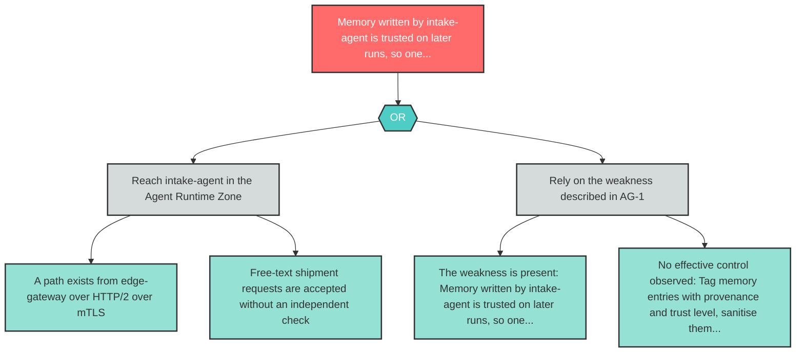

# AG-1: Memory written by intake-agent is trusted on later runs, so one...

**Component**: intake-agent | **Risk Level**: Critical | **Finding**: AG-1

Memory written by intake-agent is trusted on later runs, so one poisoned entry changes the behaviour of every future task.

