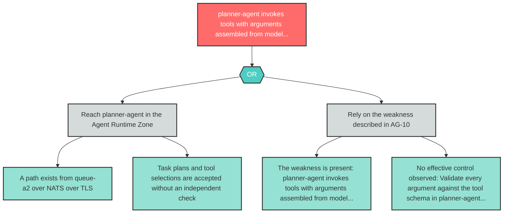

# AG-10: planner-agent invokes tools with arguments assembled from model...

**Component**: planner-agent | **Risk Level**: High | **Finding**: AG-10

planner-agent invokes tools with arguments assembled from model output, so an attacker who shapes the output can call a tool with parameters the designer never allowed.

