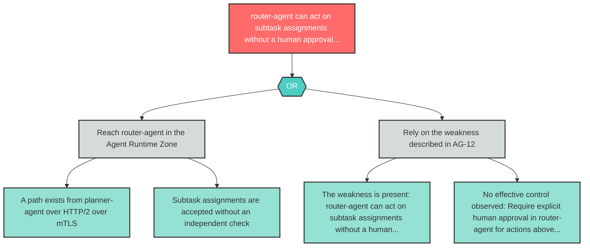

# AG-12: router-agent can act on subtask assignments without a human...

**Component**: router-agent | **Risk Level**: High | **Finding**: AG-12

router-agent can act on subtask assignments without a human approval step, so a manipulated plan executes high-impact actions with no checkpoint.

