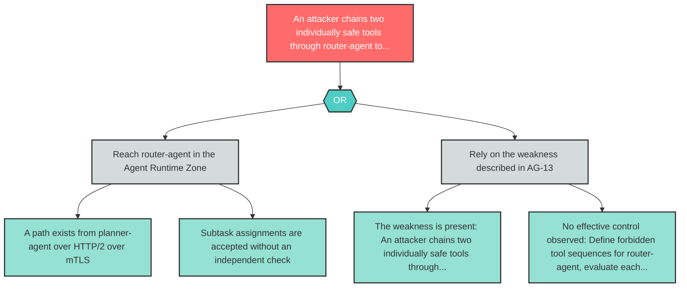

# AG-13: An attacker chains two individually safe tools through...

**Component**: router-agent | **Risk Level**: Critical | **Finding**: AG-13

An attacker chains two individually safe tools through router-agent to reach an outcome neither was approved for, such as an export followed by an upload.

