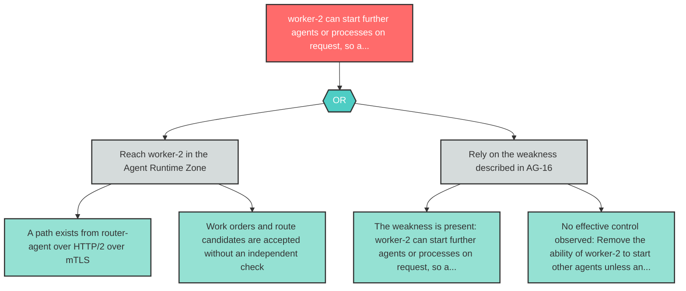

# AG-16: worker-2 can start further agents or processes on request, so a...

**Component**: worker-2 | **Risk Level**: High | **Finding**: AG-16

worker-2 can start further agents or processes on request, so a compromised prompt can multiply its reach beyond the intended scope.

