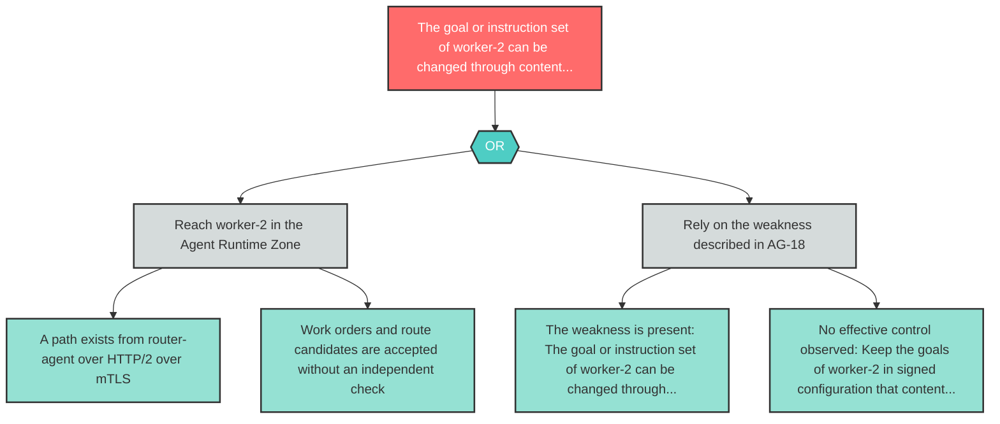

# AG-18: The goal or instruction set of worker-2 can be changed through...

**Component**: worker-2 | **Risk Level**: High | **Finding**: AG-18

The goal or instruction set of worker-2 can be changed through content it reads, steering it toward actions its operators never intended.

