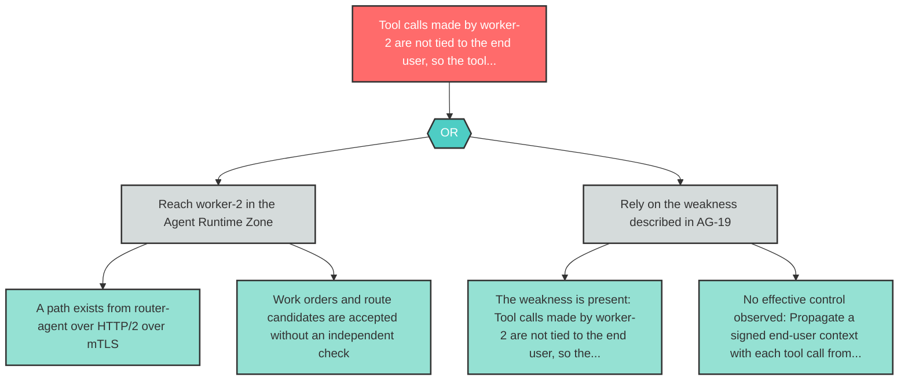

# AG-19: Tool calls made by worker-2 are not tied to the end user, so the...

**Component**: worker-2 | **Risk Level**: High | **Finding**: AG-19

Tool calls made by worker-2 are not tied to the end user, so the tool server cannot tell whose authority a request carries.

