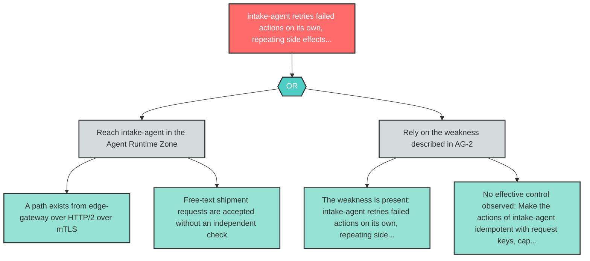

# AG-2: intake-agent retries failed actions on its own, repeating side...

**Component**: intake-agent | **Risk Level**: Critical | **Finding**: AG-2

intake-agent retries failed actions on its own, repeating side effects such as bookings or messages when the first attempt partly succeeded.

