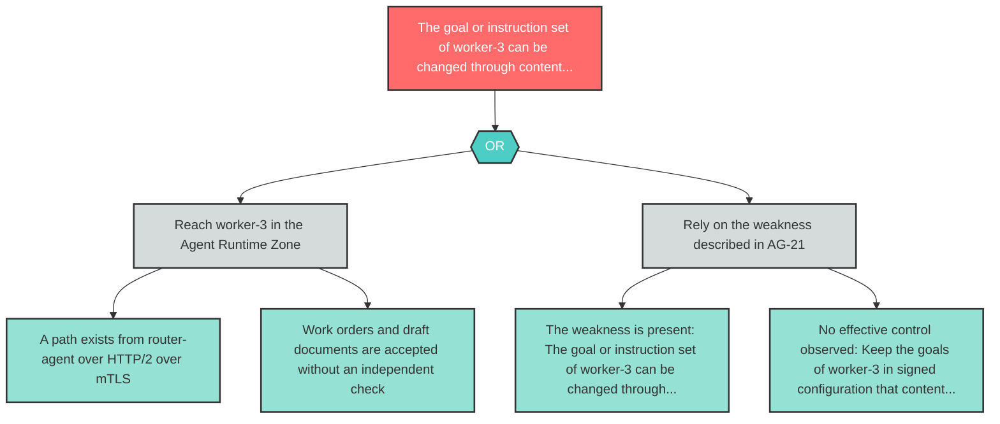

# AG-21: The goal or instruction set of worker-3 can be changed through...

**Component**: worker-3 | **Risk Level**: Critical | **Finding**: AG-21

The goal or instruction set of worker-3 can be changed through content it reads, steering it toward actions its operators never intended.

