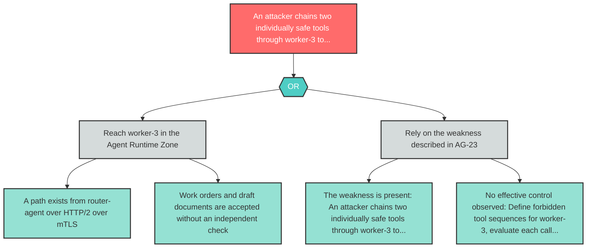

# AG-23: An attacker chains two individually safe tools through worker-3 to...

**Component**: worker-3 | **Risk Level**: High | **Finding**: AG-23

An attacker chains two individually safe tools through worker-3 to reach an outcome neither was approved for, such as an export followed by an upload.

