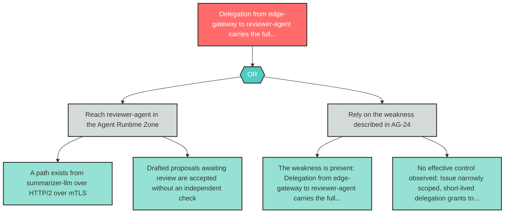

# AG-24: Delegation from edge-gateway to reviewer-agent carries the full...

**Component**: reviewer-agent | **Risk Level**: High | **Finding**: AG-24

Delegation from edge-gateway to reviewer-agent carries the full authority of the original session, so a low-trust sub-task can use high-trust rights.

