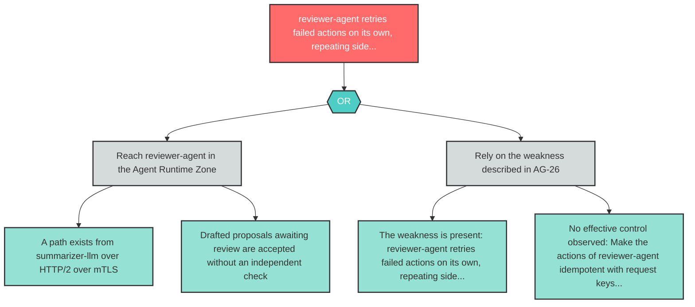

# AG-26: reviewer-agent retries failed actions on its own, repeating side...

**Component**: reviewer-agent | **Risk Level**: High | **Finding**: AG-26

reviewer-agent retries failed actions on its own, repeating side effects such as bookings or messages when the first attempt partly succeeded.

