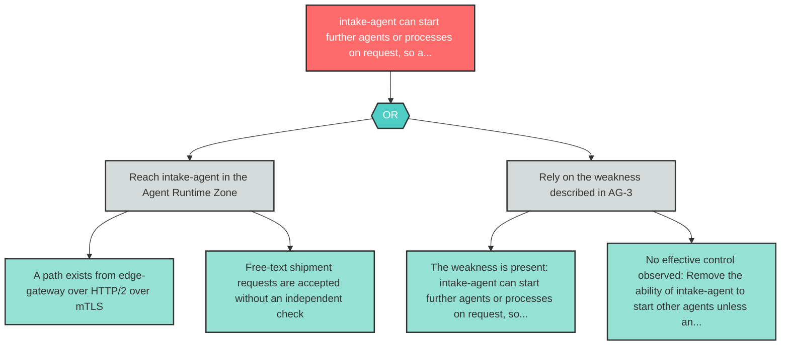

# AG-3: intake-agent can start further agents or processes on request, so...

**Component**: intake-agent | **Risk Level**: High | **Finding**: AG-3

intake-agent can start further agents or processes on request, so a compromised prompt can multiply its reach beyond the intended scope.

