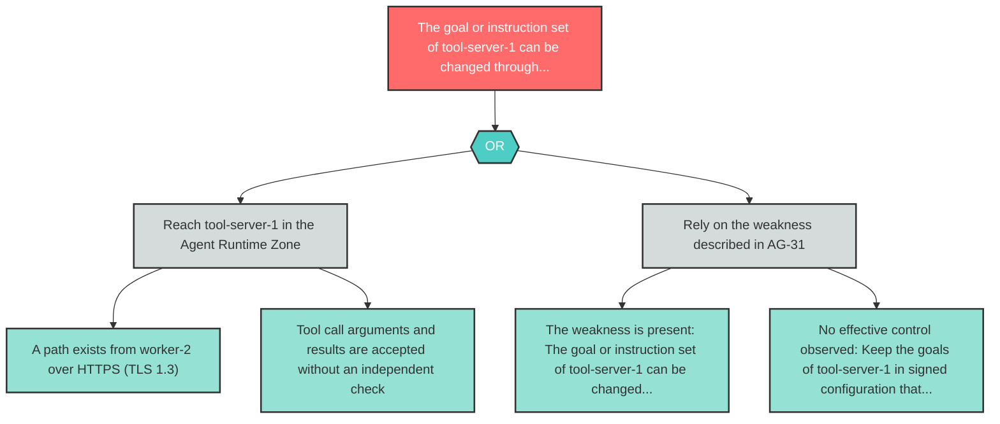

# AG-31: The goal or instruction set of tool-server-1 can be changed...

**Component**: tool-server-1 | **Risk Level**: Critical | **Finding**: AG-31

The goal or instruction set of tool-server-1 can be changed through content it reads, steering it toward actions its operators never intended.

