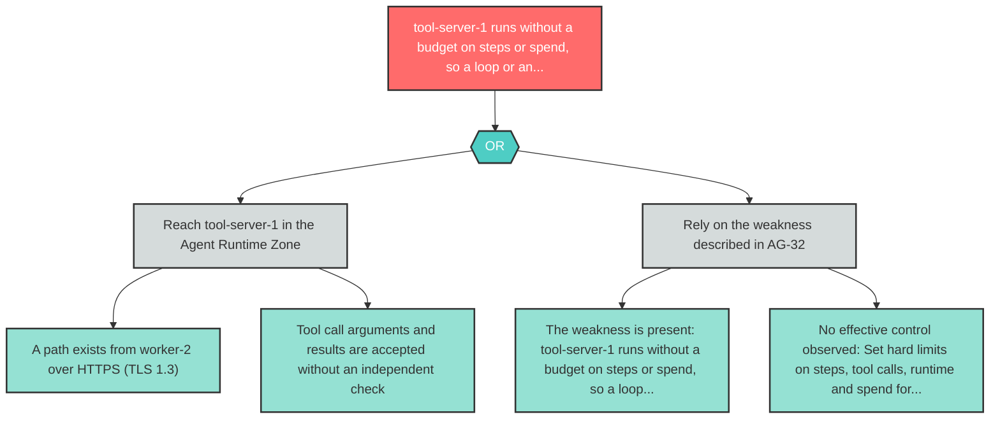

# AG-32: tool-server-1 runs without a budget on steps or spend, so a loop...

**Component**: tool-server-1 | **Risk Level**: High | **Finding**: AG-32

tool-server-1 runs without a budget on steps or spend, so a loop or an adversarial task keeps it acting long after it stopped being useful.

