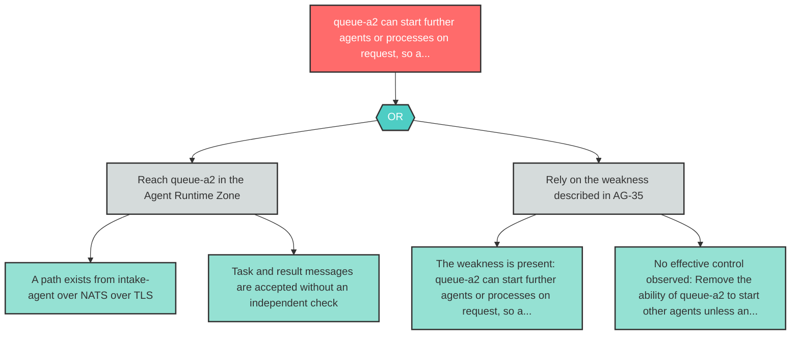

# AG-35: queue-a2 can start further agents or processes on request, so a...

**Component**: queue-a2 | **Risk Level**: High | **Finding**: AG-35

queue-a2 can start further agents or processes on request, so a compromised prompt can multiply its reach beyond the intended scope.

