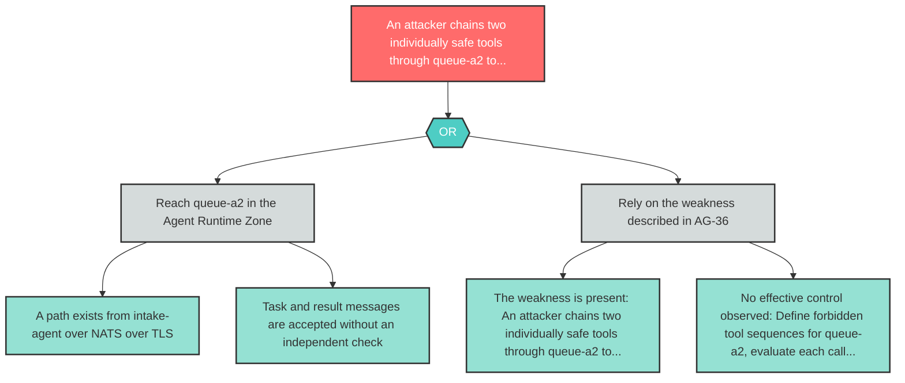

# AG-36: An attacker chains two individually safe tools through queue-a2 to...

**Component**: queue-a2 | **Risk Level**: Critical | **Finding**: AG-36

An attacker chains two individually safe tools through queue-a2 to reach an outcome neither was approved for, such as an export followed by an upload.

