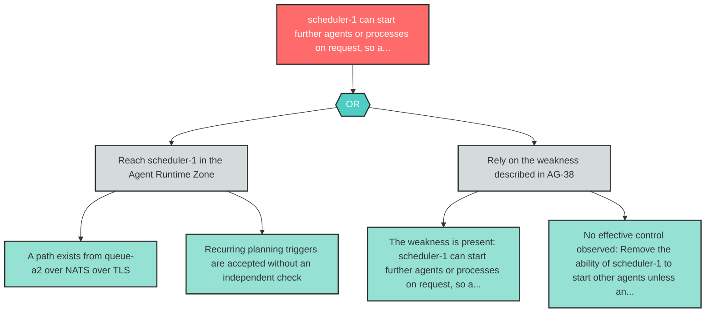

# AG-38: scheduler-1 can start further agents or processes on request, so a...

**Component**: scheduler-1 | **Risk Level**: High | **Finding**: AG-38

scheduler-1 can start further agents or processes on request, so a compromised prompt can multiply its reach beyond the intended scope.

