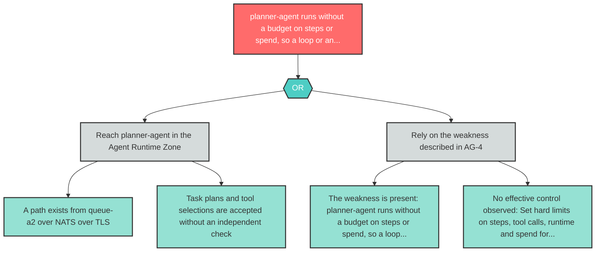

# AG-4: planner-agent runs without a budget on steps or spend, so a loop...

**Component**: planner-agent | **Risk Level**: High | **Finding**: AG-4

planner-agent runs without a budget on steps or spend, so a loop or an adversarial task keeps it acting long after it stopped being useful.

