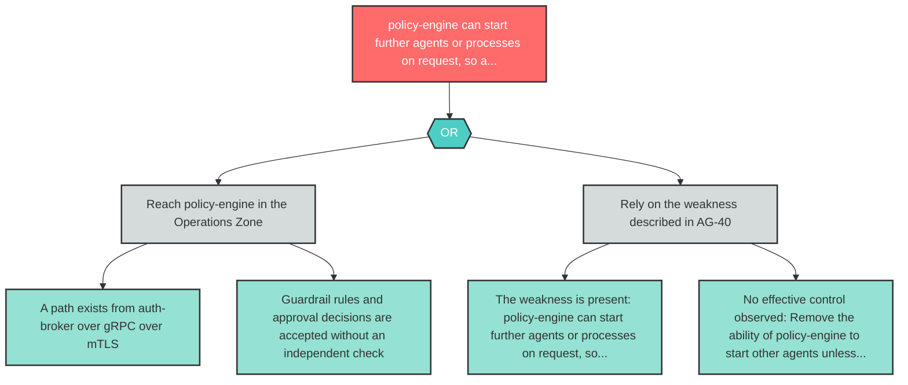

# AG-40: policy-engine can start further agents or processes on request, so...

**Component**: policy-engine | **Risk Level**: High | **Finding**: AG-40

policy-engine can start further agents or processes on request, so a compromised prompt can multiply its reach beyond the intended scope.

