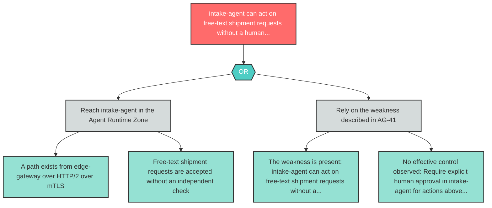

# AG-41: intake-agent can act on free-text shipment requests without a...

**Component**: intake-agent | **Risk Level**: Critical | **Finding**: AG-41

intake-agent can act on free-text shipment requests without a human approval step, so a manipulated plan executes high-impact actions with no checkpoint.

