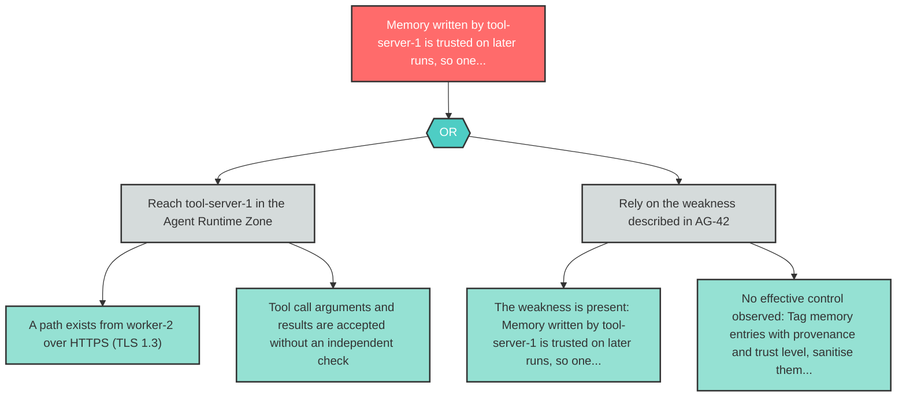

# AG-42: Memory written by tool-server-1 is trusted on later runs, so one...

**Component**: tool-server-1 | **Risk Level**: High | **Finding**: AG-42

Memory written by tool-server-1 is trusted on later runs, so one poisoned entry changes the behaviour of every future task.

