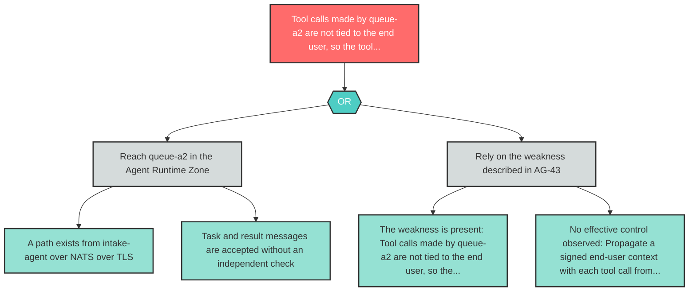

# AG-43: Tool calls made by queue-a2 are not tied to the end user, so the...

**Component**: queue-a2 | **Risk Level**: High | **Finding**: AG-43

Tool calls made by queue-a2 are not tied to the end user, so the tool server cannot tell whose authority a request carries.

