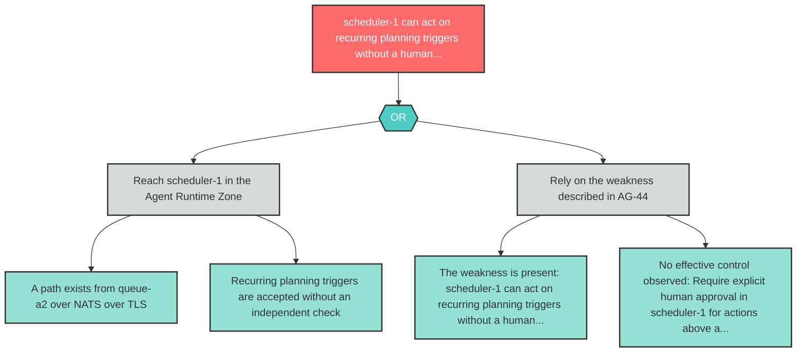

# AG-44: scheduler-1 can act on recurring planning triggers without a human...

**Component**: scheduler-1 | **Risk Level**: Critical | **Finding**: AG-44

scheduler-1 can act on recurring planning triggers without a human approval step, so a manipulated plan executes high-impact actions with no checkpoint.

