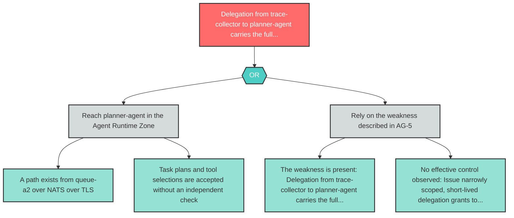

# AG-5: Delegation from trace-collector to planner-agent carries the full...

**Component**: planner-agent | **Risk Level**: High | **Finding**: AG-5

Delegation from trace-collector to planner-agent carries the full authority of the original session, so a low-trust sub-task can use high-trust rights.

