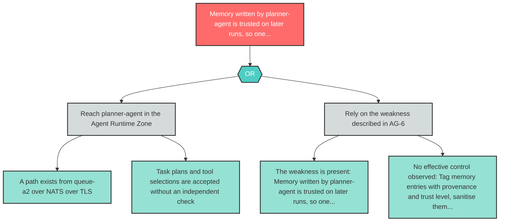

# AG-6: Memory written by planner-agent is trusted on later runs, so one...

**Component**: planner-agent | **Risk Level**: High | **Finding**: AG-6

Memory written by planner-agent is trusted on later runs, so one poisoned entry changes the behaviour of every future task.

