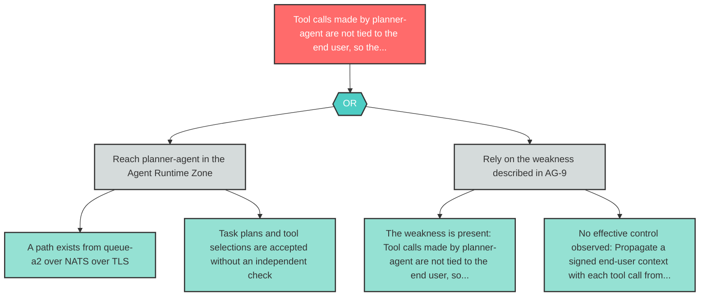

# AG-9: Tool calls made by planner-agent are not tied to the end user, so...

**Component**: planner-agent | **Risk Level**: Critical | **Finding**: AG-9

Tool calls made by planner-agent are not tied to the end user, so the tool server cannot tell whose authority a request carries.

