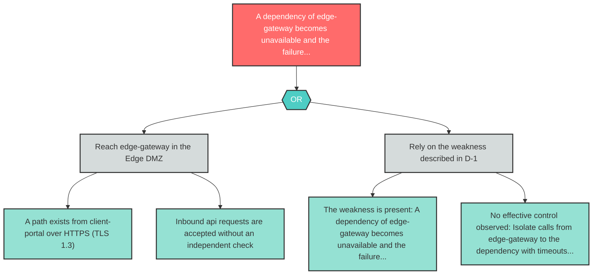

# D-1: A dependency of edge-gateway becomes unavailable and the failure...

**Component**: edge-gateway | **Risk Level**: High | **Finding**: D-1

A dependency of edge-gateway becomes unavailable and the failure cascades because edge-gateway waits on it synchronously for every request.

