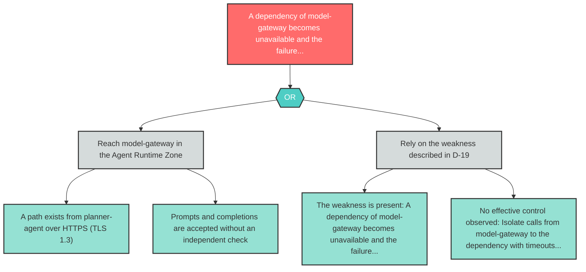

# D-19: A dependency of model-gateway becomes unavailable and the failure...

**Component**: model-gateway | **Risk Level**: High | **Finding**: D-19

A dependency of model-gateway becomes unavailable and the failure cascades because model-gateway waits on it synchronously for every request.

