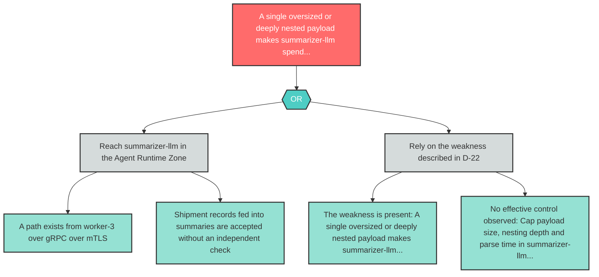

# D-22: A single oversized or deeply nested payload makes summarizer-llm...

**Component**: summarizer-llm | **Risk Level**: High | **Finding**: D-22

A single oversized or deeply nested payload makes summarizer-llm spend disproportionate memory and CPU parsing shipment records fed into summaries.

