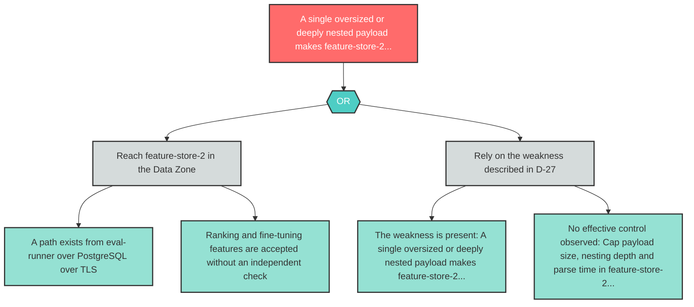

# D-27: A single oversized or deeply nested payload makes feature-store-2...

**Component**: feature-store-2 | **Risk Level**: High | **Finding**: D-27

A single oversized or deeply nested payload makes feature-store-2 spend disproportionate memory and CPU parsing ranking and fine-tuning features.

