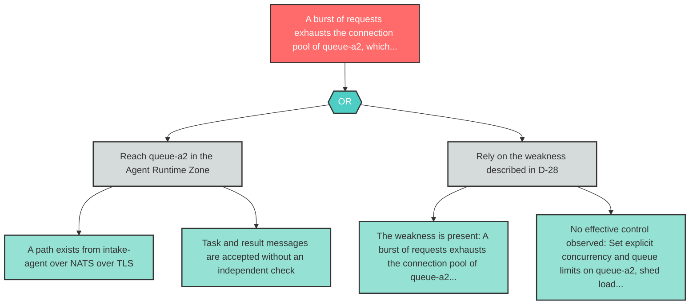

# D-28: A burst of requests exhausts the connection pool of queue-a2...

**Component**: queue-a2 | **Risk Level**: High | **Finding**: D-28

A burst of requests exhausts the connection pool of queue-a2, which queues work without a bound and blocks legitimate use of task and result messages.

