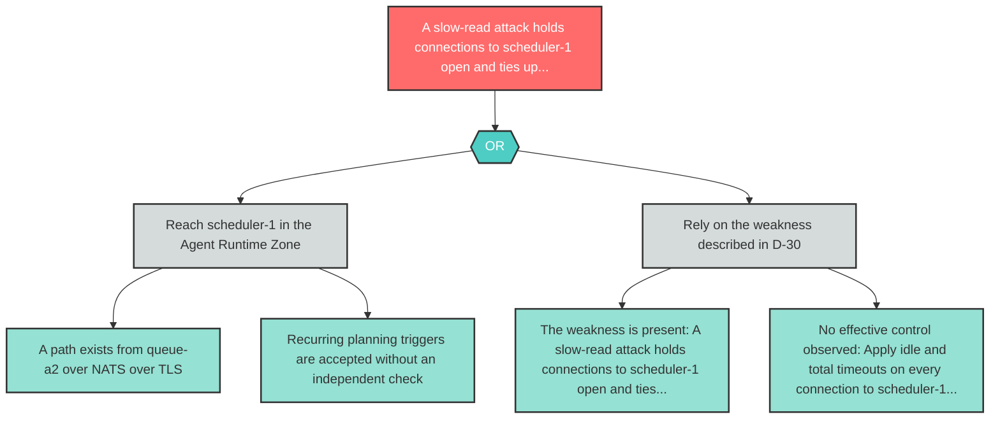

# D-30: A slow-read attack holds connections to scheduler-1 open and ties...

**Component**: scheduler-1 | **Risk Level**: High | **Finding**: D-30

A slow-read attack holds connections to scheduler-1 open and ties up the workers handling recurring planning triggers until none remain for real requests.

