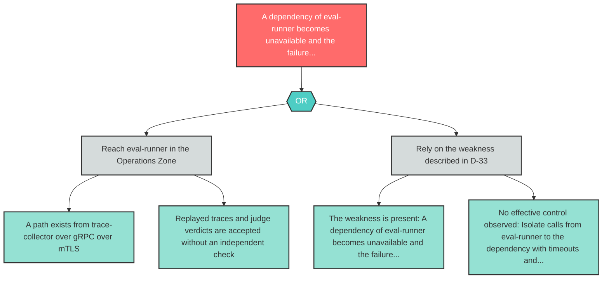

# D-33: A dependency of eval-runner becomes unavailable and the failure...

**Component**: eval-runner | **Risk Level**: High | **Finding**: D-33

A dependency of eval-runner becomes unavailable and the failure cascades because eval-runner waits on it synchronously for every request.

