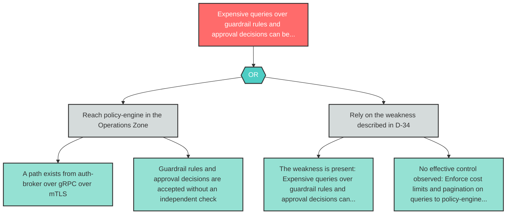

# D-34: Expensive queries over guardrail rules and approval decisions can...

**Component**: policy-engine | **Risk Level**: Critical | **Finding**: D-34

Expensive queries over guardrail rules and approval decisions can be triggered by any authorised caller of policy-engine, so one user can degrade the service for all.

