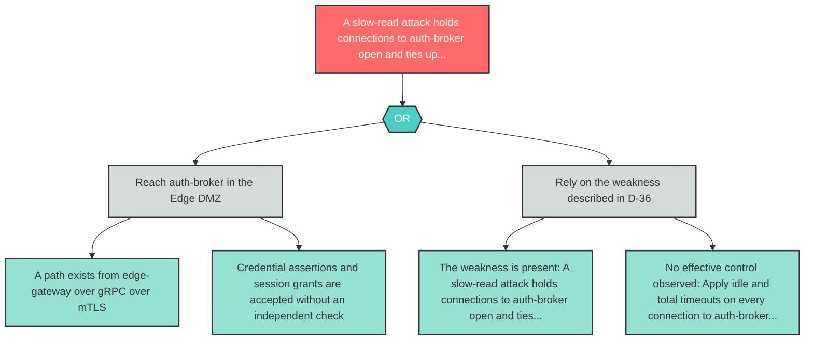

# D-36: A slow-read attack holds connections to auth-broker open and ties...

**Component**: auth-broker | **Risk Level**: High | **Finding**: D-36

A slow-read attack holds connections to auth-broker open and ties up the workers handling credential assertions and session grants until none remain for real requests.

