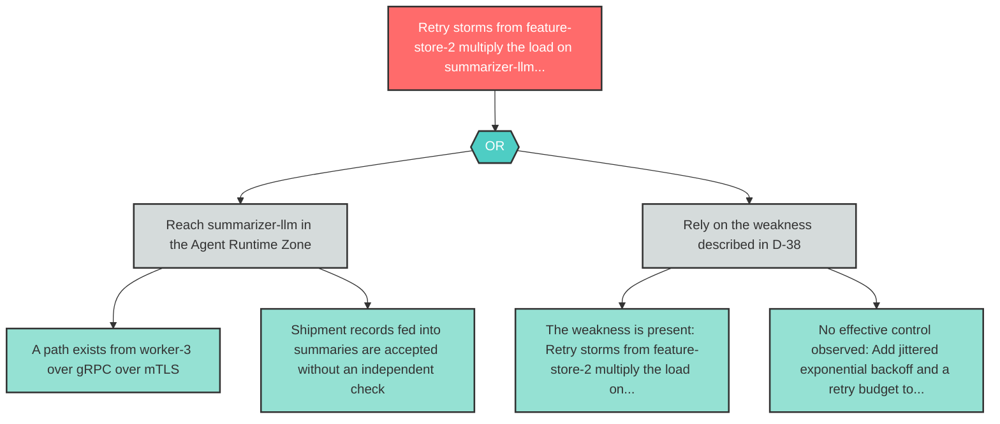

# D-38: Retry storms from feature-store-2 multiply the load on...

**Component**: summarizer-llm | **Risk Level**: Critical | **Finding**: D-38

Retry storms from feature-store-2 multiply the load on summarizer-llm when it slows down, turning a brief delay into a sustained outage.

