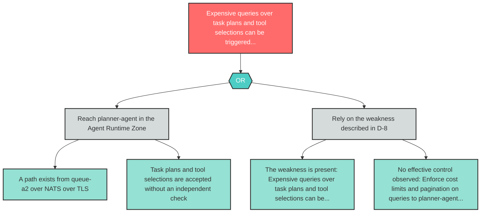

# D-8: Expensive queries over task plans and tool selections can be...

**Component**: planner-agent | **Risk Level**: Critical | **Finding**: D-8

Expensive queries over task plans and tool selections can be triggered by any authorised caller of planner-agent, so one user can degrade the service for all.

