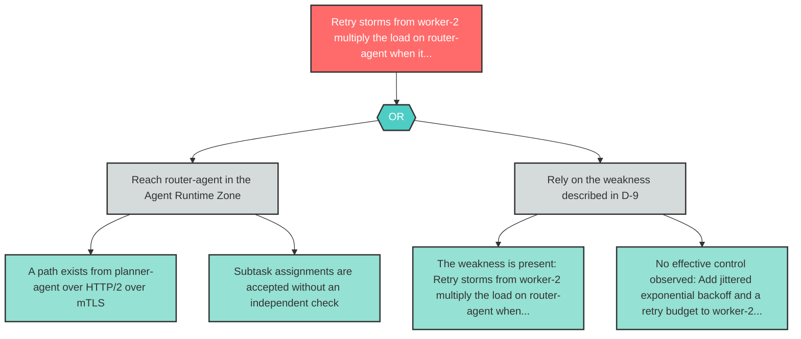

# D-9: Retry storms from worker-2 multiply the load on router-agent when...

**Component**: router-agent | **Risk Level**: Critical | **Finding**: D-9

Retry storms from worker-2 multiply the load on router-agent when it slows down, turning a brief delay into a sustained outage.

