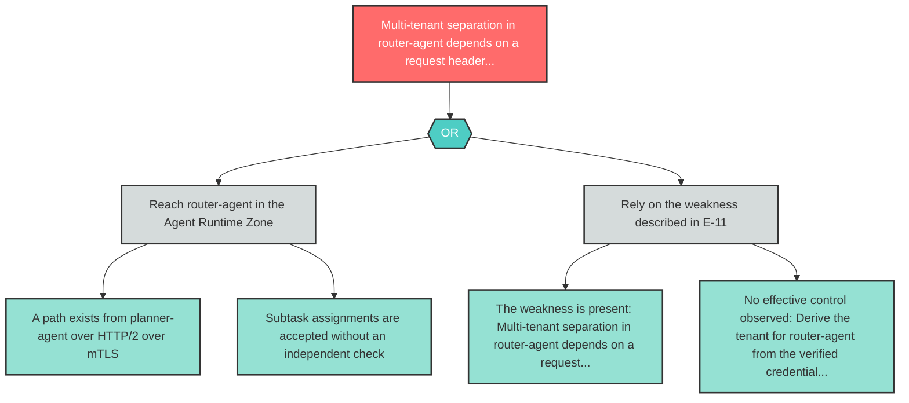

# E-11: Multi-tenant separation in router-agent depends on a request...

**Component**: router-agent | **Risk Level**: High | **Finding**: E-11

Multi-tenant separation in router-agent depends on a request header that clients can set, allowing one tenant to act in another's scope.

