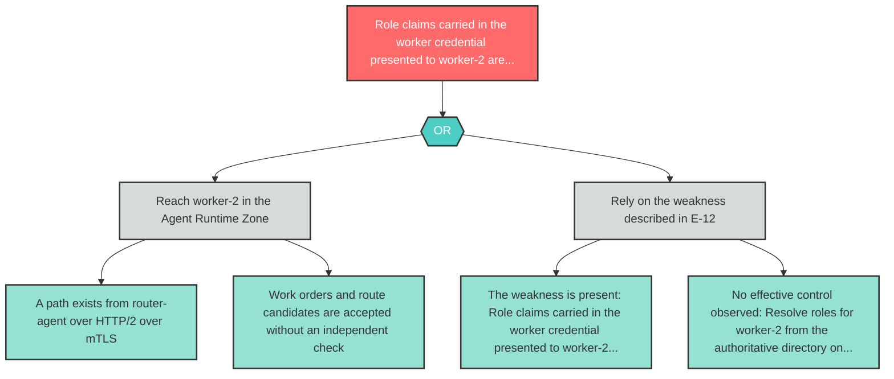

# E-12: Role claims carried in the worker credential presented to worker-2...

**Component**: worker-2 | **Risk Level**: High | **Finding**: E-12

Role claims carried in the worker credential presented to worker-2 are honoured without confirmation against the authoritative directory.

