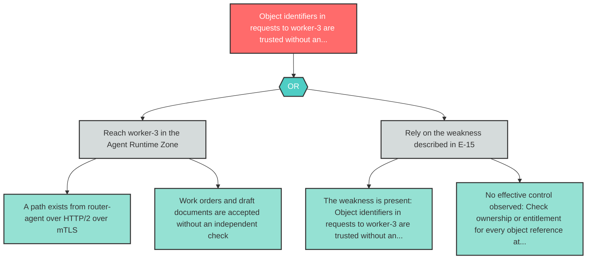

# E-15: Object identifiers in requests to worker-3 are trusted without an...

**Component**: worker-3 | **Risk Level**: High | **Finding**: E-15

Object identifiers in requests to worker-3 are trusted without an ownership check, so a caller can read or change work orders and draft documents that belong to others.

