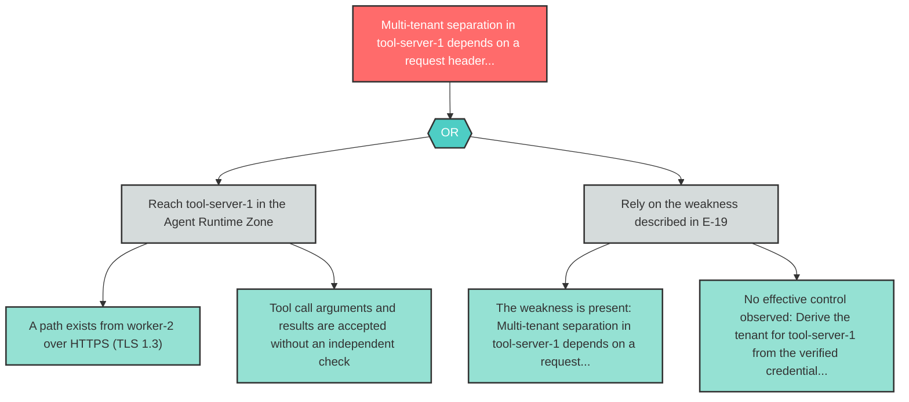

# E-19: Multi-tenant separation in tool-server-1 depends on a request...

**Component**: tool-server-1 | **Risk Level**: Critical | **Finding**: E-19

Multi-tenant separation in tool-server-1 depends on a request header that clients can set, allowing one tenant to act in another's scope.

