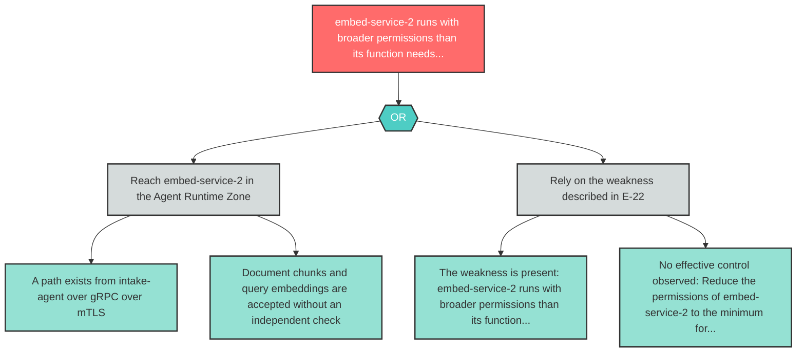

# E-22: embed-service-2 runs with broader permissions than its function...

**Component**: embed-service-2 | **Risk Level**: High | **Finding**: E-22

embed-service-2 runs with broader permissions than its function needs, so a flaw in handling document chunks and query embeddings yields access to unrelated resources.

