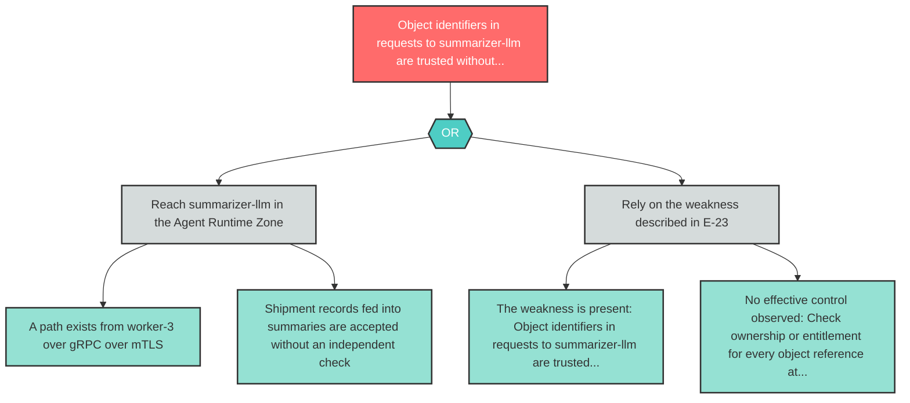

# E-23: Object identifiers in requests to summarizer-llm are trusted...

**Component**: summarizer-llm | **Risk Level**: Critical | **Finding**: E-23

Object identifiers in requests to summarizer-llm are trusted without an ownership check, so a caller can read or change shipment records fed into summaries that belong to others.

