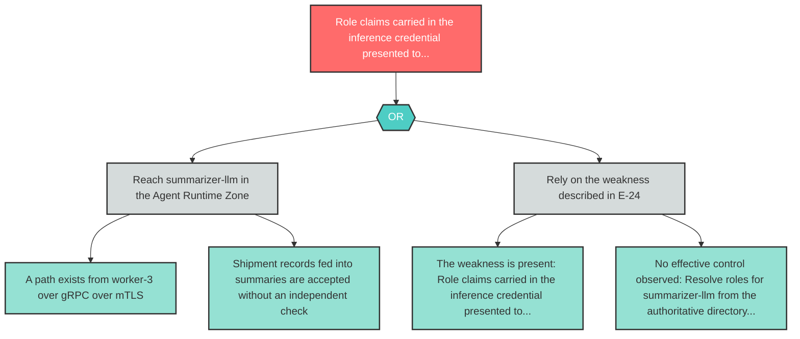

# E-24: Role claims carried in the inference credential presented to...

**Component**: summarizer-llm | **Risk Level**: High | **Finding**: E-24

Role claims carried in the inference credential presented to summarizer-llm are honoured without confirmation against the authoritative directory.

