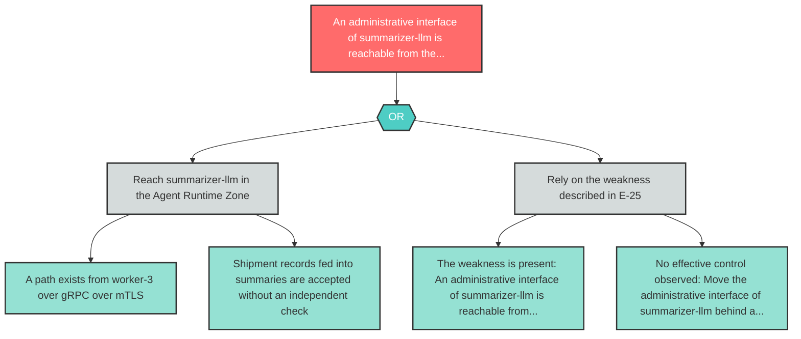

# E-25: An administrative interface of summarizer-llm is reachable from...

**Component**: summarizer-llm | **Risk Level**: High | **Finding**: E-25

An administrative interface of summarizer-llm is reachable from the same network as ordinary callers and relies on a single shared password.

